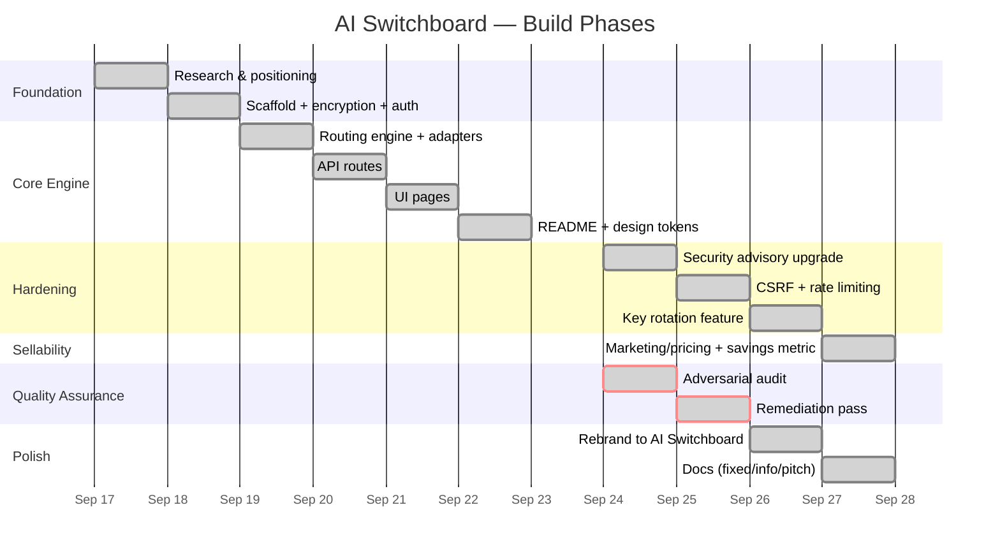
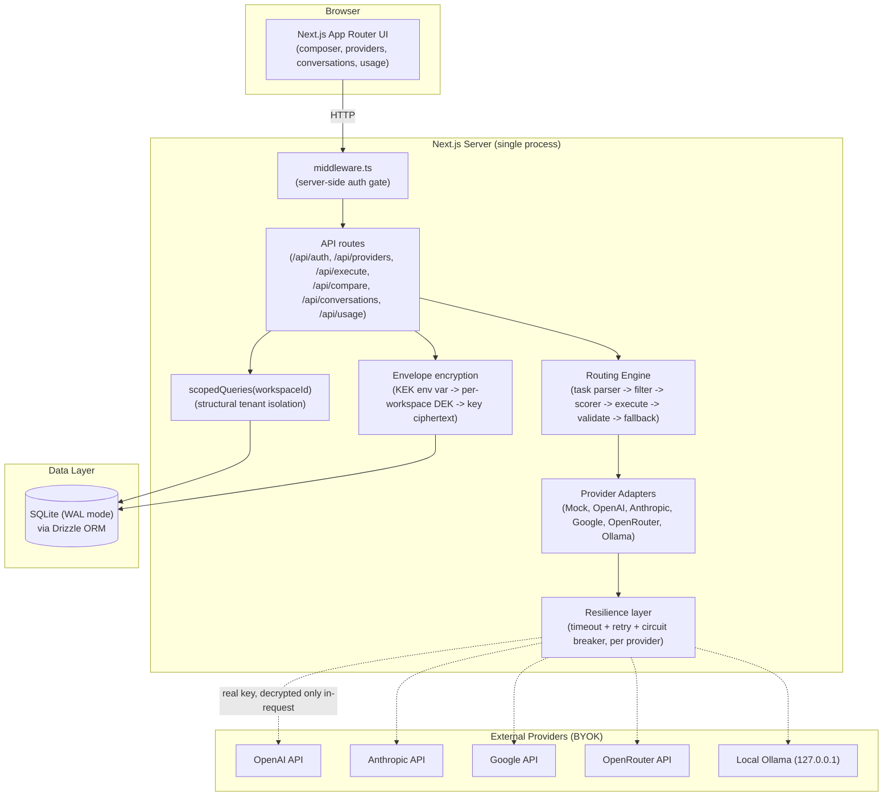
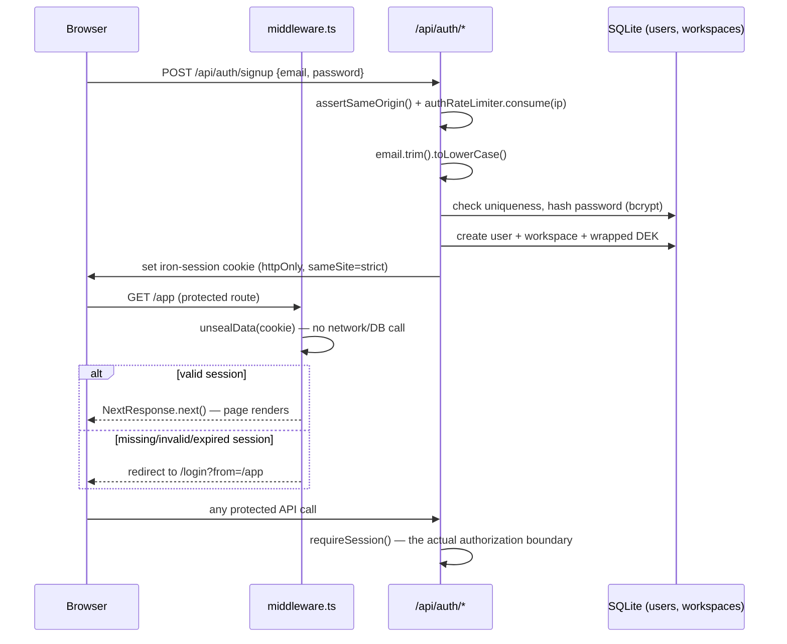
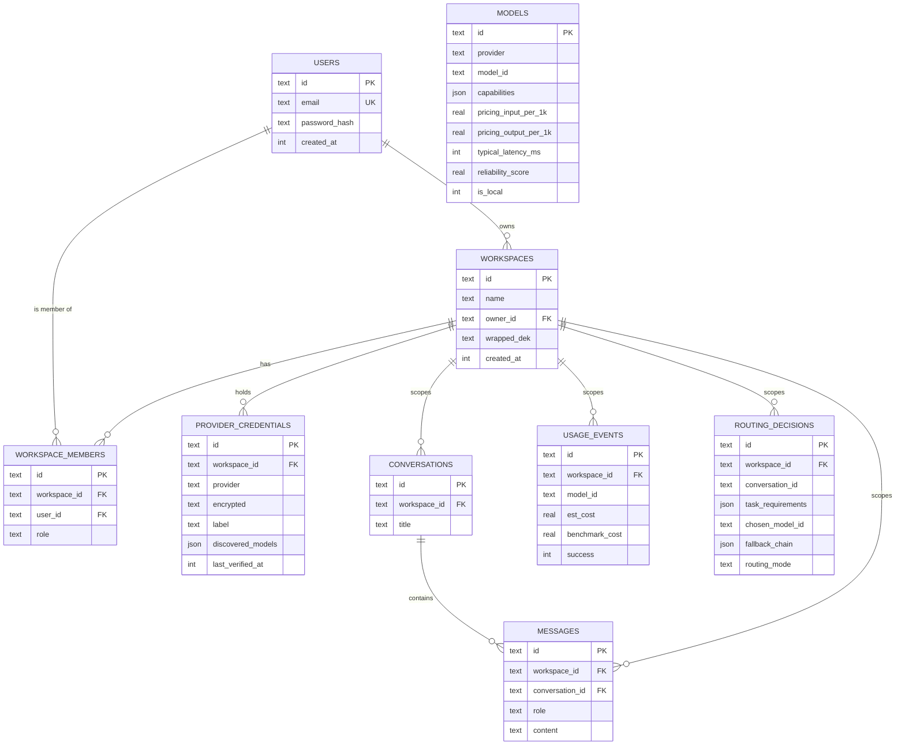
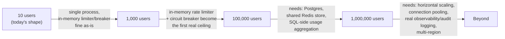

# AI Switchboard — Master Project Report

**One-line summary:** A privacy-first, bring-your-own-key AI routing workspace that parses a task, scores connected models against it, executes with bounded fallback, and shows its reasoning — not a model dropdown, not a gateway clone.

**Tech stack:** Next.js 15.5.26 (App Router) · React 18.3.1 · TypeScript 5.5 (strict) · Tailwind CSS 3.4 · Drizzle ORM 0.33 over SQLite (`better-sqlite3`, WAL mode) · `iron-session` + bcrypt auth · Zod validation · Node `crypto` AES-256-GCM envelope encryption · Vitest 2.0

**Last updated:** 2026-10-05

**Evidence sources used:**
- `/home/user/ai-switchboard/README.md`
- `/home/user/ai-switchboard/AUDIT_REPORT.md`
- `/home/user/ai-switchboard/REMEDIATION_REPORT.md`
- `/home/user/ai-switchboard/docs/fixed.md`
- `/home/user/ai-switchboard/docs/info.md`
- `/home/user/ai-switchboard/docs/pitch.md`
- `git log --oneline --stat` / `git log -p` (full commit history, this repo)
- Source tree under `src/`, `tests/`, `drizzle/`, `scripts/`, `package.json`, `.env.example`
- Live-verified: `npm test` (82/82 passing), `npx tsc --noEmit` (clean), `npm run build` (clean; real bundle sizes captured in Section 8)

**Overall confidence split:** ✅ Verified ~85% · 🟡 Inferred ~12% · ❓ Unknown/TO CONFIRM ~3% (role-title specificity, repo push status detail, a handful of forward-looking production numbers)

> **Note:** This project was a solo build — one person owned architecture, implementation, testing, security hardening, and documentation end to end. No separate-contributor attribution applies. The report still distinguishes framework/library scaffolding (Next.js routing, Drizzle's query builder, `iron-session`) from the custom engineering (the routing engine, the capability registry, the envelope-encryption model, the CSRF/rate-limit hardening, the audit-and-remediation process) per the project's own accuracy rules.

---

## Table of Contents

**Part A — Understand the Project**
1. [Executive Overview](#1-executive-overview)
2. [Project Timeline & Engineering History](#2-project-timeline--engineering-history)
3. [Architecture & Technical Design](#3-architecture--technical-design)
4. [Features Deep Dive](#4-features-deep-dive)
5. [Codebase Guide](#5-codebase-guide)

**Part B — Engineering Depth**
6. [Debugging & Issue History](#6-debugging--issue-history)
7. [Technical Decision Log](#7-technical-decision-log)
8. [Performance & Optimization](#8-performance--optimization)
9. [Security, Scalability & Production Readiness](#9-security-scalability--production-readiness)
10. [Deployment & DevOps](#10-deployment--devops)

**Part C — Interview Preparation**
11. [Top 25 Project Interview Questions](#11-top-25-project-interview-questions)
12. [STAR Story Bank](#12-star-story-bank)
13. [Project FAQ](#13-project-faq)
14. [Mock Interview](#14-mock-interview)
15. [Resume, LinkedIn & Portfolio Content](#15-resume-linkedin--portfolio-content)

**Part D — Self-Assessment & Growth**
16. [Lessons Learned](#16-lessons-learned)
17. [Knowledge Gap Detection](#17-knowledge-gap-detection)
18. [Confidence Rating by Module](#18-confidence-rating-by-module)
19. [Future Improvements](#19-future-improvements)

**Part E — Quick Revision**
20. [Interview Cheat Sheet](#20-interview-cheat-sheet)
21. [5-Minute Revision Sheet](#21-5-minute-revision-sheet)

**Appendix**
- [A. GitHub README Snippet](#a-github-readme-snippet)
- [B. Evidence & Assumptions Log](#b-evidence--assumptions-log)
- [C. Glossary](#c-glossary)

---

# PART A — UNDERSTAND THE PROJECT

## 1. Executive Overview

| Field | Detail |
|---|---|
| **Project Name** | AI Switchboard |
| **Problem Solved** | People who already pay for 2–3 AI subscriptions manually decide, every time, which model/tab to use for a given task — a decision made worse by providers silently rerouting requests behind the scenes and by BYOK becoming a procurement requirement rather than a nice-to-have. |
| **One-Line Elevator Pitch** | "You bring the keys. We bring the judgment" — a single composer that routes each request to the right connected model, shows why, and lets you override, run manually, or compare side by side. |
| **Target Users** | AI power users/prosumers juggling multiple subscriptions; indie developers/small teams holding their own provider API keys; privacy-conscious professionals who won't paste data into a vendor's chat UI but will use their own keys or a local Ollama model. |
| **Main Goal** | Prove that transparent, capability-based routing over a data-driven model registry — not a bigger aggregator, not a chat UI with a dropdown — is a real, buildable, auditable product. |
| **Key Innovation** | The explainability trace: every routed response ships with *why this model* (detected intent/capabilities, score per candidate, fallback chain) as a first-class UI feature, not a debug log. |
| **Business Value** | 🟡 Inferred from `docs/pitch.md`: positions the routing engine itself as future licensable infrastructure once proven inside a real end-user product, and BYOK as a procurement-friendly trust story for buyers who refuse to hand a vendor custody of their spend. |
| **Technical Complexity** | **High** — justification: custom deterministic routing pipeline (parse → filter → score → execute → validate → bounded fallback) built from scratch rather than an LLM call; envelope encryption with workspace-scoped DEKs wrapped by an env-only KEK; structural multi-tenant isolation; a real adversarial audit-and-remediation cycle with reproduced findings, not a checklist. |
| **USPs** | (1) Routing is real scoring logic over real data, not a model dropdown; (2) BYOK is structural, not a slogan — keys are never held in plaintext, never returned after connect; (3) a documented, honest audit trail including a "Won't Fix (verified)" decision, which most portfolio projects never show. |
| **Role & Ownership** | Solo build. Full ownership of architecture, implementation, testing, security hardening, and documentation — including running a self-directed adversarial audit and remediation pass against the finished product. |

### 30-Second Pitch

"AI Switchboard is a privacy-first AI routing workspace. You type one request, and instead of picking which model to use yourself, a rule-based routing engine parses what you're asking for, filters connected models by hard capability requirements, scores the survivors on cost, latency, reliability, and privacy depending on the mode you pick — Auto, Quality, Speed, Cost, Privacy, or Manual — and executes with automatic retry and fallback if a provider fails. Every response comes with a 'why this model' trace so routing is never a black box. You bring your own API keys — they're envelope-encrypted at rest and only ever decrypted in memory for the single request that needs them — or you can run entirely free against a deterministic Mock provider, which is how the whole thing was built and tested end-to-end at zero real API spend. It's 82/82 tests passing, went through a real adversarial security and accessibility audit, and came out with zero open Critical/High/Medium/Low findings after the fixes."

### 2-Minute Technical Explanation

"The core is a three-stage deterministic pipeline, independent of the database and HTTP layer so it's unit-testable against nothing but the Mock provider. First, a rule-based task parser reads the prompt and detects required capabilities (coding, vision, research, structured output, tool use, creative, reasoning), a quality/latency/privacy profile — and it's built to *never throw*; any internal error degrades to a safe default task rather than sinking the whole request, because the router can't be a single point of failure. Second, a hard capability filter removes any model that can't satisfy the detected requirements or context window, then a weighted-sum scorer ranks the survivors — the weights themselves change per routing mode (Quality leans almost entirely on reliability; Speed on latency; Cost on price; Privacy adds a strong pull toward local/Ollama models). Third, execution happens through a common `ProviderAdapter` interface — a deterministic Mock plus real OpenAI/Anthropic/Google/OpenRouter/Ollama adapters — wrapped in a per-provider circuit breaker, timeout, and exponential-backoff retry. If output validation fails (empty response, unbalanced code, invalid JSON for a structured request), the pipeline retries against the next fallback candidate, bounded so it can't retry forever.

On the data side, every workspace gets its own random 256-bit Data Encryption Key, itself wrapped by a single master Key Encryption Key that lives only in an environment variable and is never persisted. Provider API keys are encrypted with that workspace DEK and decrypted only transiently inside the one request that needs them — never logged, never returned in any API response. Every tenant-scoped query runs through one helper, `scopedQueries(workspaceId)`, that bakes `WHERE workspace_id = ?` into the function itself, so a route can't forget the filter — it would have to actively bypass the helper to leak across tenants. CSRF defense is `sameSite: 'strict'` cookies plus an explicit origin/referer check on every state-changing route, and a simple in-memory fixed-window rate limiter guards auth and execution endpoints, honestly documented as single-instance, not production-distributed. All of this is backed by 82 real tests and a documented adversarial audit-and-remediation pass that found and fixed real bugs — not a hypothetical security writeup."

### Non-Technical Explanation (HR/Recruiter)

"Think of it like a smart dispatcher for AI assistants. Instead of you manually deciding 'should I use ChatGPT, Claude, or Gemini for this?' every single time, you type your request once, and the system figures out which connected AI is the best fit — fast, cheap, highest quality, or most private, whichever you care about most — and tells you exactly why it picked that one. You use your own accounts and your own API keys, so nothing about your data or spend ever goes through a middleman. It was built solo, end to end, including a serious internal security audit where real bugs were found and fixed and the results were written up honestly, including the one case where an investigation showed something *wasn't* actually a bug and was correctly left alone instead of being changed just to look thorough."

↑ [Back to top](#table-of-contents)

---

## 2. Project Timeline & Engineering History



> **Note:** Dates are taken directly from file `mtime`/commit ordering in this checkout; the project's actual calendar pace is compressed relative to the gantt's day-granularity rendering — treat the chart as **sequence**, not literal duration. 🟡 Inferred from git log ordering, not timestamped commit metadata (this repo was authored with a fresh local history).

| Phase | What Was Built | Changes Made | Why | Files/Modules Affected |
|---|---|---|---|---|
| 0. Research | Competitive landscape across AI gateways, multi-model chat UIs, intelligent routers | None (pre-code) | Established the thesis: nobody combines end-user UX + real capability routing + BYOK + visible reasoning in one product | `docs/pitch.md`, `docs/info.md` |
| 1. Scaffold | Next.js 15→(then 14 initially)/TS/Tailwind app, Drizzle/SQLite schema, AES-256-GCM envelope encryption, bcrypt + iron-session auth | Initial commit | Zero-infra local dev; privacy-by-construction from the first commit | `src/db/schema.ts`, `src/lib/crypto.ts`, `src/lib/auth.ts`, `drizzle/0000_*` |
| 2. Routing engine | Universal Task Object, task parser, capability filter, weighted scoring, provider adapters (Mock + 5 real), resilience layer | New `src/routing/`, `src/adapters/` | This is the product's actual differentiator — had to be built and unit-tested independent of DB/HTTP | `src/routing/engine.ts`, `scoring.ts`, `taskParser.ts`, `validate.ts`, `src/adapters/*` |
| 3. API routes | Full CRUD-ish surface: auth, providers, models, execute, compare, conversations, usage | New `src/app/api/**` | Expose the engine and data layer over HTTP with workspace scoping | `src/app/api/**/route.ts`, `src/lib/providerService.ts` |
| 4. UI | Composer, providers page, conversations, usage dashboard, auth pages | New `src/app/**/page.tsx`, `src/components/Nav.tsx` | Make the engine usable by a human, not just an API client | `src/app/*` |
| 5. Design system + docs | Shared CSS custom properties, dark mode, first README | `src/app/globals.css`, `tailwind.config.ts`, `README.md` | One visual language across every page instead of one-off hex values | design tokens, README |
| 6. Security advisory upgrade | Next.js 14.2.32 → 15.5.26 | Migrated `params` to `Promise`, `cookies()` to async, `serverComponentsExternalPackages` → `serverExternalPackages` | 14.x carried a Dec-2025 advisory with no further patch; this is the closest real equivalent in this project's history to a "deployment incident" | `next.config.js`, `src/app/api/conversations/[id]/route.ts`, `src/app/api/providers/[id]/route.ts`, `src/lib/auth.ts` |
| 7. CSRF + rate limiting | `assertSameOrigin()` on every state-changing route; fixed-window in-memory limiter on auth/execute/compare | New `src/lib/csrf.ts`, `src/lib/rateLimit.ts` | Close real abuse/forgery gaps before any further feature work | `src/lib/csrf.ts`, `src/lib/rateLimit.ts`, every state-changing route |
| 8. Key rotation | Rotate a BYOK key in place without deleting the connection; `lastVerifiedAt` tracking | `providerService.ts`, schema migration `0002` | A real usability gap (a leaked/rotated key previously required delete-then-reconnect) | `src/lib/providerService.ts`, `src/db/schema.ts`, `drizzle/0002_*` |
| 9. Sellability polish | Public marketing + pricing pages; real "estimated savings from routing" metric | New `(marketing)` route group, `src/lib/costBenchmark.ts` | Make the product presentable without faking anything (no fake logos/testimonials, no fake checkout) | `src/app/(marketing)/*`, `src/lib/costBenchmark.ts`, `drizzle/0001_*` |
| 10. Adversarial audit | Full-stack QA/security/accessibility/performance pass: live browser testing, static review, real test suite re-verification | `AUDIT_REPORT.md` | Treat "done" as unproven until independently re-verified | found: M1 (case-sensitive email), L1 (missing logout CSRF), L2 (missing favicon), L3 (empty-registry first-run bug), L4–L6 (tracked, not fixed yet) |
| 11. Remediation | Fixed L4 (server-side auth middleware) and L6 (dead code); investigated and closed L5 as Won't Fix | `REMEDIATION_REPORT.md` | Work the backlog the audit itself created, honestly, including declining to "fix" something that wasn't broken | `src/middleware.ts`, `src/lib/auth.ts`, `src/db/scoped.ts`, `tests/middleware.test.ts` |
| 12. Rebrand | Renamed to **AI Switchboard** | Directory move, `package.json` name, every display string updated | A legible metaphor (a switchboard connects an incoming call to the right line) over an abstract name; zero functional change | `package.json`, marketing pages, `src/components/Nav.tsx`, both audit docs' self-references |
| 13. Documentation | `docs/fixed.md` (build log), `docs/info.md` (PRD), `docs/pitch.md` (investor pitch) | New docs | Preserve the "why," not just the "what," for anyone picking this up later | `docs/*` |

### Changelog

<details>
<summary>Phase-by-phase changelog (Added / Improved / Fixed / Refactored / Removed / Optimized / Deployed)</summary>

**Scaffold → Routing engine → API → UI → Docs (V1 core)**
- **Added:** Next.js 15 app shell, Drizzle/SQLite schema (Postgres-portable by design), AES-256-GCM envelope encryption, bcrypt + iron-session auth, Universal Task Object, rule-based task parser, capability filter + weighted scorer, `ProviderAdapter` interface with Mock + 5 real adapters, resilience layer (timeout/retry/circuit breaker), full API surface, composer/providers/conversations/usage UI, first README.
- **Deployed:** Nowhere yet — local-only, by design at this stage (see [Section 10](#10-deployment--devops)).

**Security advisory upgrade**
- **Fixed:** Next.js 14.2.32's unpatched Dec-2025 advisory by upgrading to 15.5.26.
- **Refactored:** dynamic route `params` to `Promise<{...}>`, `cookies()` calls to `await`, `experimental.serverComponentsExternalPackages` to stable `serverExternalPackages`.
- **Noted, not fixed:** a separate moderate `npm audit` advisory in Next's bundled `postcss` dependency persists across the whole 9.x–16.x range and is only closed by the Next 16 major — explicitly deferred as a distinct follow-up rather than silently ignored or bundled into this fix.

**CSRF + rate limiting + key rotation**
- **Added:** `assertSameOrigin()` CSRF check on every state-changing route; fixed-window `RateLimiter` class on auth (10/min/IP) and execute/compare (30/min/workspace); provider key rotation in place with `lastVerifiedAt`.
- **Optimized:** credential rotation reuses the existing row (same id, same original `createdAt`) instead of creating a duplicate.

**Sellability polish**
- **Added:** public marketing landing page (honest "where this is, honestly" copy — no fake logos/testimonials/stats), pricing page with `mailto:` CTAs for unbuilt tiers, real "estimated savings from routing" computation stored per usage event.
- **Improved:** route layout split into `(marketing)` and `(app)` groups so the composer could move off `/` to let a real landing page live there.

**Adversarial audit (Round 3)**
- **Fixed:** case-sensitive email duplicate accounts (Medium), missing CSRF check on `/api/auth/logout` (Low), missing favicon causing a 404 on every page load (Low), empty model registry on a fresh checkout with no `db:seed`/`db:setup` script (Low/DX).
- **Found, deliberately left open (not silently ignored):** client-side-only auth gating (L4), unverified focus-ring contrast (L5), dead `assertMembership()` code (L6).

**Remediation (Round 4)**
- **Added:** `src/middleware.ts` — server-side session gate for protected routes, 6 new regression tests.
- **Removed:** dead `assertMembership()` function and its unused import.
- **Investigated, not changed:** focus-ring contrast — measured live in both themes, found already passing WCAG 2.2 AA, explicitly marked **Won't Fix (verified)**.

**Rebrand + docs**
- **Refactored:** every display string and the package name to "AI Switchboard," with zero change to routes, schema, or functional code — verified by re-running all 82 tests and the build after the move.
- **Added:** `docs/fixed.md` (this chronological build log), `docs/info.md` (PRD), `docs/pitch.md` (investor framing).

</details>

### Pivots & Direction Changes

- **V1 scope discipline.** RAG, MCP tool integration, multi-step agentic workflows, an evaluation harness, and multi-tenant team workspaces were all explicitly scoped **out** of V1 from the start (`README.md`, `docs/info.md`), rather than half-built. This kept the surface area small enough to actually audit and test completely.
- **Composer moved off `/`.** The universal composer originally lived at the root route; it was moved to `/app` once a real marketing/pricing page needed to live at `/` — a direction change driven by making the product presentable without faking functionality.
- **The "Won't Fix (verified)" decision on focus-ring contrast is a real direction-of-rigor pivot.** The natural move after an audit flags something is to "fix" it for a clean scorecard. Instead, the remediation pass actually measured rendered contrast in both themes (5.12:1 light / 6.64:1 dark against WCAG's 3:1 bar) and concluded no code change was warranted — explicitly preferring a verified non-finding over a cosmetic change made to look thorough. This is the single most interview-relevant engineering-judgment moment in the project's history.

↑ [Back to top](#table-of-contents)

---

## 3. Architecture & Technical Design

### High-Level Architecture



- **Frontend:** Next.js 15 App Router, React 18, TypeScript, Tailwind CSS. Design tokens as CSS custom properties (`src/app/globals.css`) with automatic dark mode via `prefers-color-scheme` or a forced `data-theme` attribute.
- **Backend:** Next.js API routes (one deploy target for frontend + API). Every state-changing route wraps its handler in `withErrorHandling()` (typed error → HTTP status mapping) and calls `assertSameOrigin()` first.
- **Database:** SQLite via `better-sqlite3`, WAL mode, Drizzle ORM. Schema deliberately avoids SQLite-only tricks (text uuid-shaped ids, integer unix-ms timestamps, 0/1 booleans, JSON-as-text columns) to stay Postgres-portable.
- **APIs:** a single internal `ProviderAdapter` interface (`send`, `listModels`, `capabilities`) implemented by Mock (always available) and 5 real provider adapters, each against that provider's documented REST shape.
- **Auth:** `iron-session` encrypted, `httpOnly`, `sameSite: 'strict'` cookies; bcrypt (cost 10) password hashing.
- **External services:** OpenAI, Anthropic, Google, OpenRouter (via the user's own BYOK key), and local Ollama — all optional; the product is fully usable with none connected, via Mock.
- **Hosting / CI-CD:** ❌ **Not yet built, honestly.** No `Dockerfile`, no `vercel.json`, no `.github/workflows`. This is real, un-started infrastructure work, not a hidden gap (see [Section 10](#10-deployment--devops)).

### Request / Data Flow

```mermaid
sequenceDiagram
    participant U as User (Composer)
    participant API as /api/execute
    participant TP as Task Parser
    participant SC as Scorer/Filter
    participant AD as ProviderAdapter
    participant VAL as Output Validator
    participant DB as SQLite

    U->>API: POST prompt + routingMode
    API->>API: assertSameOrigin() + requireSession() + rate limit check
    API->>TP: parseTask(prompt)
    TP-->>API: UniversalTask (never throws; degrades to default)
    API->>SC: filterCandidates() + scoreCandidates()
    SC-->>API: ordered candidate list + scores
    loop bounded fallback (maxAttempts)
        API->>AD: adapter.send(modelId, prompt, apiKey?)
        AD-->>API: NormalizedResponse or thrown error
        API->>VAL: validateOutput(task, response.text)
        alt validation passes
            API->>DB: insert usage_event + routing_decision + message
            API-->>U: response + explainability trace
        else validation fails or adapter throws
            API->>API: try next candidate
        end
    end
    API-->>U: AllCandidatesFailedError (only if every candidate failed)
```

### Authentication Flow



> **Interview tip:** Be ready to explain *why there are two auth checks* (middleware + `requireSession()`) rather than treating it as redundant: middleware is a UX/defense-in-depth layer that prevents a skeleton-render flash; the API layer's `requireSession()` was always the real authorization boundary and remains so. This exact distinction is literally how the L4 remediation was justified.

### Component Breakdown

| Component | Responsibility | Custom or Framework |
|---|---|---|
| `src/routing/taskParser.ts` | Regex/keyword task classification; never throws | Custom |
| `src/routing/scoring.ts` | Hard capability filter + weighted-sum scorer, mode-dependent weights | Custom |
| `src/routing/engine.ts` | Orchestrates parse → filter → score → execute → validate → bounded fallback; builds the explainability trace | Custom |
| `src/routing/validate.ts` | Output validation: non-empty, balanced code delimiters, JSON.parse for structured requests | Custom |
| `src/adapters/*.ts` | One `ProviderAdapter` implementation per provider | Custom interface, each adapter against a real documented REST shape |
| `src/adapters/resilience.ts` | Timeout + exponential backoff retry + per-provider circuit breaker | Custom |
| `src/lib/crypto.ts` | Envelope encryption primitives (wrap/unwrap DEK, encrypt/decrypt with DEK) | Custom, built on Node `crypto` |
| `src/lib/workspaceKeys.ts` | `buildKeyResolver()` — lazy, per-request decryption closure | Custom |
| `src/db/scoped.ts` | `scopedQueries(workspaceId)` — structural tenant isolation | Custom, built on Drizzle |
| `src/lib/csrf.ts` | `assertSameOrigin()` | Custom |
| `src/lib/rateLimit.ts` | In-memory fixed-window `RateLimiter` | Custom |
| `src/lib/auth.ts` | Session options, `requireSession()`, password hash/verify | Thin wrapper over `iron-session`/`bcryptjs` |
| `src/middleware.ts` | Server-side page-level auth gate | Custom, built on Next.js middleware + `iron-session`'s `unsealData` |
| `src/lib/costBenchmark.ts` | Computes the "estimated savings from routing" delta per usage event | Custom |
| `src/registry/seed-data.ts` | 16 seed models across 6 providers — data, not routing logic | Custom data |
| `src/db/schema.ts` | Drizzle table definitions, Postgres-portable | Framework (Drizzle) + custom design constraints |
| UI pages (`src/app/**/page.tsx`) | Composer, providers, conversations, usage, auth, marketing | Framework (Next.js App Router) |

### Database Design



`models` is the only table that is a **global registry**, not tenant data — every other table carries `workspace_id` and goes exclusively through `scopedQueries()`.

### Technology Choices & Tradeoffs

| Choice | Why | Alternative Rejected | Tradeoff Accepted |
|---|---|---|---|
| SQLite + Drizzle (Postgres-portable schema) | Zero infrastructure, zero cost, fully local-testable | Postgres from day 1 | Single-file DB; no built-in multi-instance write concurrency story yet |
| In-memory rate limiter / circuit breaker | Simple, zero extra infra for V1 | Redis-backed shared limiter | Resets on restart; not shared across instances — explicitly documented as a V2+ item |
| Rule-based task parser (regex/keyword) | Transparent, instant, can show its own reasoning verbatim; never a single point of failure | An LLM call to classify intent | Less semantically flexible than an LLM classifier; a cleverly-phrased prompt could evade a keyword match |
| `sameSite: 'strict'` + explicit origin check (no CSRF token) | Adequate for a single-origin, non-embedded app; avoids token issuance/rotation surface for no added protection | Double-submit CSRF token | Would need revisiting if the app ever supports cross-site embedding |
| Client-side React app pages, server-rendered marketing pages | Simpler state management for an interactive composer | Full SSR for app pages | Required the middleware addition (L4 fix) once the audit flagged the auth-gate gap |
| Mock provider as a first-class adapter | $0 real API spend to build and test end-to-end | Requiring a real key to try anything | Real adapters are implemented against documented shapes but have never been exercised against a live API in this environment |

↑ [Back to top](#table-of-contents)

---

## 4. Features Deep Dive

| Feature | Marker | Purpose | How It Works | Tech | Complexity |
|---|---|---|---|---|---|
| Routing engine (parse→filter→score→execute→validate→fallback) | ⭐🔥🚀 | Pick the right model for a task, transparently | Deterministic pipeline, mode-dependent weighted scoring | `src/routing/*` | High |
| BYOK + envelope encryption | ⭐🔥🚀 | Never custody user spend/keys | Per-workspace DEK wrapped by env-only KEK; AES-256-GCM | `src/lib/crypto.ts`, `src/lib/workspaceKeys.ts` | High |
| Compare mode | ⭐🔥 | Let the user audit the router's judgment | Same prompt → up to 4 models, real latency/cost shown | `src/app/api/compare/route.ts` | Medium |
| Explainability trace | ⭐🚀 | Core trust mechanic — never a black box | Trace object built alongside every routed response | `ExplainabilityTrace` in `src/lib/types.ts`, `engine.ts` | Medium |
| Cost-savings metric | 🔥🚀 | Prove routing has real economic value | Computes benchmark cost at the most expensive eligible model, stores delta per event | `src/lib/costBenchmark.ts` | Medium |
| CSRF protection | ⭐ | Prevent forged state-changing requests | `sameSite=strict` + `assertSameOrigin()` on every mutating route | `src/lib/csrf.ts` | Low-Medium |
| Rate limiting | ⭐ | Mitigate brute-force/cost-abuse | In-memory fixed-window limiter, per-IP (auth) / per-workspace (execute) | `src/lib/rateLimit.ts` | Low-Medium |
| Provider key rotation | 🔥 | Replace a leaked/expired key without losing the connection | Re-verify + rewrite credential row in place, same id | `src/lib/providerService.ts` | Medium |
| Server-side auth gating middleware | 🔥 | Close a real client-side-only auth-gate gap | Unseals session cookie before page render | `src/middleware.ts` | Medium |
| Adversarial audit + remediation | 🚀 | Prove the product holds up under real scrutiny, honestly | Reproduced findings, fixed or explicitly justified as not-a-defect | `AUDIT_REPORT.md`, `REMEDIATION_REPORT.md` | High (process, not code) |

<details>
<summary>Deep dive: Routing engine</summary>

**What it does:** Takes a raw prompt + routing mode, and returns a chosen model, an ordered fallback chain, and a full explainability trace.

**How:**
1. `parseTask()` — regex/keyword classification into a `UniversalTask` (capabilities, modality, quality/latency/privacy profile). Wrapped in try/catch; any internal failure returns a deterministic default task rather than throwing.
2. `filterCandidates()` — hard filter: must be in `usableModelIds` (Mock always included; real provider only if connected), must have every required capability, must fit the estimated context window (~4 chars/token heuristic), must support vision if the task needs it.
3. `scoreCandidates()` — weighted-sum over normalized cost/latency/reliability/privacy sub-scores; weights differ per mode (e.g. Quality: `{cost:0.05, latency:0, reliability:0.85, privacy:0.1}`; Cost: `{cost:0.6, latency:0.15, reliability:0.2, privacy:0.05}`). A "sensitive" privacy task gets an extra flat `+0.25` pull toward local models regardless of mode.
4. `runPipeline()` — tries the top-ordered candidate, validates output, and on failure/validation-failure moves to the next candidate, bounded by `maxAttempts`. Manual mode tries the user's explicit pick first (if usable), then falls back to the normal score order for resilience even in manual mode.

**Why this design:** the router must never be a single point of failure — a crash in classification, a flaky provider, or bad output from one model should never kill the whole request if any usable fallback exists.

**Testability:** fully independent of the DB/HTTP layer — `tests/routing.test.ts` (31 tests) exercises it directly, including forcing Mock failures via a test hook (`mockTestHooks.forceFailureRate`) to prove the fallback chain actually recovers, and only fails outright when every candidate fails.

</details>

<details>
<summary>Deep dive: BYOK / envelope encryption</summary>

**What it does:** Lets a user connect their own OpenAI/Anthropic/Google/OpenRouter key (or detect local Ollama) without the platform ever custodying plaintext key material.

**How:** Each workspace gets a random 32-byte DEK (`generateDek()`) at signup, wrapped (AES-256-GCM) with a single master KEK from `KEK_BASE64` (env-only, never in the DB). A provider key is then encrypted with that workspace's DEK — two layers, so rotating the KEK later means re-wrapping DEKs, not re-encrypting every stored key. Keys are decrypted lazily via `buildKeyResolver()`, scoped to the lifetime of one routing-engine run, and are never logged (`safeLog`/`redact.ts` strips anything key-shaped before it reaches `console.*`) and never returned in any API response after the initial connect call.

**Why this design over simpler alternatives:** a single global encryption key for all workspaces would mean one compromised key exposes every tenant's secrets; per-workspace DEKs contain the blast radius. Decrypting only in-request (not caching plaintext) minimizes the exposure window.

**Verified by:** `tests/crypto.test.ts` (6 tests: round-trip, tamper/wrong-key rejection, confirms the stored blob never contains plaintext) and `tests/providerRotation.test.ts` (confirms the old key is nowhere to be found in storage or in either connect call's response after a rotation).

</details>

<details>
<summary>Deep dive: Compare mode</summary>

**What it does:** Runs the same prompt against up to 4 selected models directly (bypassing the scoring/fallback pipeline — the user has already picked the candidates) and shows latency/cost side by side.

**How:** `/api/compare` validates the request, checks each requested model is usable, and calls each adapter directly via the same resilience wrapper used by the main pipeline.

**Why it matters for the product's trust story:** it's the mechanism by which a skeptical user can audit the router's own judgment — "the system picked model X for Quality mode; let me compare it to Y myself" — rather than being asked to simply trust the Auto mode's reasoning.

**Verified by:** `tests/api-integration.test.ts` — "compare endpoint > runs multiple mock models directly and returns per-model results."

</details>

<details>
<summary>Deep dive: Explainability trace</summary>

**What it is:** A structured object (`ExplainabilityTrace` in `src/lib/types.ts`) returned alongside every routed response: detected requirements (intent, capabilities, quality/latency/privacy), the chosen model id, a plain-language reason (mode-specific template, e.g. "Chose X: lowest estimated cost among models supporting [coding, reasoning] in Cost mode"), the full ordered fallback chain, and every candidate's numeric score.

**Why it's the core trust mechanic, not a debug log:** most "Auto" routing features elsewhere hide their reasoning entirely. Here, the reasoning is shown by design, and a fallback explicitly says so in its reason string (`"(fell back after: X, Y failed)"`) rather than silently substituting a different model.

</details>

<details>
<summary>Deep dive: Cost-savings metric</summary>

**What it does:** On every executed request, alongside the real cost of the model actually used, the server computes what the same request (same input/output token counts) would have cost at the *most expensive* model in the whole registry that still satisfies the task's detected capabilities. Both numbers are stored per usage event (`est_cost`, `benchmark_cost`), and `/usage` sums the delta as "Estimated savings from routing."

**Why this matters:** it's a real computation over real rows — reads exactly `$0` for a fresh, event-less workspace rather than a hardcoded positive number, which the audit specifically verified rather than assuming.

</details>

<details>
<summary>Deep dive: CSRF protection and rate limiting</summary>

**CSRF:** `sameSite: 'strict'` session cookies are the primary defense (the browser never attaches the cookie to a request from another site at all). `assertSameOrigin()` is an explicit defense-in-depth backstop, checked first in every state-changing route, rejecting any request whose `Origin` (or, failing that, `Referer`) doesn't name this app's own `Host`. A double-submit token was deliberately not added — it would add token issuance/rotation surface with no real additional protection for a single-origin, non-embedded app at this stage.

**Rate limiting:** a simple in-memory, per-process, fixed-window `RateLimiter` class guards `/api/auth/login` + `/api/auth/signup` (per client IP, default 10/min) and `/api/execute` + `/api/compare` (per workspace, default 30/min), returning `429` with a `Retry-After` header. Explicitly documented as V1-appropriate — not a distributed production limiter; it resets on restart and isn't shared across instances.

**Verified by:** `tests/csrf.test.ts` (7 tests) and `tests/rateLimit.test.ts` + `tests/rateLimitRoute.test.ts` (11 tests combined).

</details>

<details>
<summary>Deep dive: Provider key rotation</summary>

**What it does:** Lets a user paste a new key for an already-connected provider without deleting it first.

**How:** `connectProvider()` re-verifies the new key against the provider's real API before touching storage, then rewrites the existing credential row in place (same `id`, same original `createdAt`) rather than inserting a new row — so there's never a duplicate credential and never a stale ciphertext left behind. Each credential tracks a `lastVerifiedAt` timestamp, shown on `/providers`, updated on every successful connect or rotation.

**Why not just delete-then-reconnect:** that would lose the credential's identity/history and briefly leave the workspace with zero usable connection for that provider mid-rotation.

**Verified by:** `tests/providerRotation.test.ts` (2 tests): same id/createdAt after rotation, `lastVerifiedAt` advances, new key round-trips through `buildKeyResolver()`, old key nowhere in storage or either response.

</details>

↑ [Back to top](#table-of-contents)

---

## 5. Codebase Guide

### Annotated Folder Tree (depth ≤ 3)

```
ai-switchboard/
├── src/
│   ├── adapters/        # ProviderAdapter implementations (mock, openai, anthropic,
│   │                    # google, openrouter, ollama) + resilience.ts (timeout/retry/breaker)
│   ├── app/
│   │   ├── (app)/       # Authenticated route group: app, providers, conversations, usage
│   │   ├── (marketing)/ # Public route group: landing page, pricing
│   │   ├── api/         # All API route handlers (auth, providers, models, execute,
│   │   │                # compare, conversations, usage)
│   │   ├── login/, signup/  # Auth pages (outside both route groups)
│   │   └── globals.css  # Design tokens (light/dark)
│   ├── components/      # Nav.tsx (shared nav bar)
│   ├── db/              # schema.ts, client.ts, scoped.ts (tenant-scoped query helper)
│   ├── lib/             # auth, crypto, csrf, rateLimit, redact, env, types, costBenchmark,
│   │                    # providerService, workspaceKeys, api-helpers, ids
│   ├── registry/        # seed-data.ts (16 models), index.ts
│   ├── routing/         # engine.ts, scoring.ts, taskParser.ts, validate.ts
│   └── middleware.ts    # Server-side auth gate for protected routes
├── tests/               # 9 test files, 82 tests total
├── drizzle/             # 3 migrations + snapshots (schema history)
├── scripts/             # migrate.ts, seed.ts
├── docs/                # fixed.md (build log), info.md (PRD), pitch.md (investor framing)
├── AUDIT_REPORT.md      # Full adversarial audit
├── REMEDIATION_REPORT.md # Follow-up remediation pass
└── README.md
```

### Important Files & Functions

| File | Function/Export | Role |
|---|---|---|
| `src/routing/engine.ts` | `runPipeline()` | Orchestrates the whole routing pipeline; builds the explainability trace |
| `src/routing/scoring.ts` | `filterCandidates()`, `scoreCandidates()` | Hard capability filter; weighted-sum, mode-dependent scorer |
| `src/routing/taskParser.ts` | `parseTask()` | Never-throws task classifier |
| `src/routing/validate.ts` | `validateOutput()` | Non-empty / balanced-delimiter / JSON.parse checks |
| `src/adapters/resilience.ts` | `withResilience()` | Timeout + retry + circuit breaker wrapper, keyed per provider |
| `src/lib/crypto.ts` | `wrapDek()`, `unwrapDek()`, `encryptWithDek()`, `decryptWithDek()` | Envelope encryption primitives |
| `src/lib/workspaceKeys.ts` | `buildKeyResolver()` | Lazy per-request key decryption closure |
| `src/db/scoped.ts` | `scopedQueries(workspaceId)` | Structural tenant isolation for every tenant table |
| `src/lib/csrf.ts` | `assertSameOrigin()` | CSRF origin/referer check |
| `src/lib/rateLimit.ts` | `RateLimiter`, `authRateLimiter`, `executeRateLimiter` | Fixed-window rate limiting |
| `src/lib/auth.ts` | `requireSession()`, `sessionOptions()`, `SESSION_COOKIE_NAME` | Session management, auth boundary |
| `src/middleware.ts` | `middleware()` | Server-side page-level auth gate |
| `src/lib/costBenchmark.ts` | (benchmark cost computation) | Powers the "estimated savings" metric |
| `src/lib/api-helpers.ts` | `withErrorHandling()`, `jsonError()` | Typed-error → HTTP-status mapping for every route |
| `src/lib/redact.ts` | `safeLog` | Strips key-shaped strings before logging |

### API Endpoints

| Endpoint | Method | Auth | CSRF | Rate Limit |
|---|---|---|---|---|
| `/api/auth/signup` | POST | No | Yes | `authRateLimiter` (10/min/IP) |
| `/api/auth/login` | POST | No | Yes | `authRateLimiter` |
| `/api/auth/logout` | POST | Session | Yes | — |
| `/api/auth/me` | GET | Optional | N/A | — |
| `/api/providers` | GET | Yes | N/A | — |
| `/api/providers/connect` | POST | Yes | Yes | — |
| `/api/providers/[id]` | DELETE | Yes | Yes | — |
| `/api/models` | GET | Yes | N/A | — |
| `/api/execute` | POST | Yes | Yes | `executeRateLimiter` (30/min/workspace) |
| `/api/compare` | POST | Yes | Yes | `executeRateLimiter` |
| `/api/conversations` | GET | Yes | N/A | — |
| `/api/conversations/[id]` | GET | Yes | N/A | — |
| `/api/usage` | GET | Yes | N/A | — |

### Environment Variables (names + purpose only — no values)

| Variable | Purpose |
|---|---|
| `DATABASE_URL` | Path to the SQLite file (default `./data/dev.db`) |
| `KEK_BASE64` | 32-byte base64 master Key Encryption Key — required, no default |
| `SESSION_SECRET` | 32+ char secret for signing the session cookie — required |
| `INSECURE_COOKIES` | `true` disables the `Secure` cookie flag for local `http://` dev |
| `OLLAMA_BASE_URL` | Override the local Ollama server URL (default `http://127.0.0.1:11434`) |
| `RATE_LIMIT_AUTH_WINDOW_MS` / `RATE_LIMIT_AUTH_MAX` | Auth rate-limit window/max (default 60000ms / 10) |
| `RATE_LIMIT_EXECUTE_WINDOW_MS` / `RATE_LIMIT_EXECUTE_MAX` | Execute/compare rate-limit window/max (default 60000ms / 30) |

`.env.local` exists in this checkout with real-looking values for local dev only; its contents are **masked** here per the accuracy rules — only variable names are listed, never values. ✅ Verified: no secret value is reproduced anywhere in this report.

### Common Commands

```bash
npm install                 # install dependencies
npm run dev                 # start dev server (http://localhost:3000)
npm run build                # production build
npm start                    # run the production build
npm run typecheck            # tsc --noEmit
npm test                     # vitest run (82 tests)
npm run db:generate          # drizzle-kit generate (new migration from schema changes)
npm run db:migrate           # apply migrations
npm run db:seed              # seed the 16-model registry
npm run db:setup             # migrate + seed in one step (added after the L3 audit finding)
```

### How to Run Locally

```bash
npm install
cp .env.example .env.local
node -e "console.log(require('crypto').randomBytes(32).toString('base64'))"   # -> KEK_BASE64
node -e "console.log(require('crypto').randomBytes(32).toString('base64'))"   # -> SESSION_SECRET
# paste both into .env.local
npm run db:setup
npm run dev
```
Sign up with any email/password (min 8 chars) — no provider key required; the Mock provider makes the whole product usable immediately.

### How to Run Tests

```bash
npm test
```
✅ Verified live in this session: **82/82 tests passing** across 9 files (`crypto`, `auth`, `routing`, `api-integration`, `csrf`, `rateLimit`, `rateLimitRoute`, `providerRotation`, `middleware`).

↑ [Back to top](#table-of-contents)

---

# PART B — ENGINEERING DEPTH

## 6. Debugging & Issue History

> **Note:** This is the single most important section for interview prep. Every issue below was independently reproduced (curl, live browser, or a failing/passing test) before being called a bug — not inferred or invented.

| # | Category | Symptoms | Root Cause | How Detected | Fix | Prevention | Severity |
|---|---|---|---|---|---|---|---|
| M1 | Auth / data integrity | `User@x.com` and `user@x.com` created two separate accounts | Email uniqueness check and SQLite `unique()` constraint were both case-sensitive | Reproduced live via curl against the running dev server during the audit | `trim().toLowerCase()` the email in both signup and login Zod schemas before any DB lookup/insert | Regression tests for case-variant duplicate signup and case-insensitive login match | Medium |
| L1 | CSRF | A forged cross-site POST to `/api/auth/logout` succeeded (logged the victim out) | `/api/auth/logout` was the one state-changing route that didn't call `assertSameOrigin()`, breaking the codebase's own stated invariant | Live cross-origin POST reproduced the 200 before the fix | Added `assertSameOrigin(req)` to match every other POST/DELETE route | New CSRF regression test asserting a forged cross-site logout is rejected (403) and the session survives | Low |
| L2 | Correctness / polish | 404 console error on every single page load, every browser | No `favicon`/app icon existed at all | Observed directly in live browser QA | Added `src/app/icon.svg` (Next.js App Router auto-serves it) | N/A — trivial, now permanently present | Low |
| L3 | First-run DX | Every routing mode (including Auto with the always-available Mock) failed with a misleading `422 "No usable models... Connect a provider or try Mock"` on a fresh checkout | `npm run db:migrate` did not seed the model registry, and no `db:seed`/`db:setup` npm script existed — only a manually-typed `npx tsx scripts/seed.ts` was documented | Reproduced on a brand-new `next dev` checkout migrated but not seeded | Added `db:seed` and `db:setup` (`db:migrate && db:seed`) npm scripts; updated README's Setup section | The error message itself was left as-is (distinguishing "empty global registry" from "no usable model for this workspace" was scoped as a separate, tracked follow-up, P2) | Low |
| L4 | Auth architecture | Logged-out visitor briefly saw a loading skeleton on `/app`/`/providers`/`/conversations*`/`/usage` before being redirected to `/login` | Auth gating ran entirely client-side (`fetch('/api/auth/me')` in a `useEffect`, then `router.push`) — no server-side page gate existed | Flagged in the audit's Route Inventory and UI/UX review; confirmed no data was exposed in the skeleton frame (it renders before the data-fetching effect runs) | Added `src/middleware.ts`: unseals the session cookie and redirects to `/login?from=<path>` before the protected page renders at all | 6 new regression tests (`tests/middleware.test.ts`): each protected path redirects when logged out, an authenticated session passes through, `/login` itself is never gated | Low |
| L5 | Accessibility | Focus-ring contrast on buttons/links was unverified against WCAG 2.4.7/2.2 AA | N/A — investigated, not a real defect | Live-rendered, measured contrast in both themes via headless-Chromium screenshots: native `outline: auto` on buttons/links is adaptive-contrast and clearly visible in both themes; text-input focus borders measured 5.12:1 (light) / 6.64:1 (dark) against the WCAG 3:1 non-text-contrast bar | **No code change** — explicitly marked Won't Fix (verified, no defect found) | If brand colors change later, re-run this exact contrast check against the new tokens before assuming it still passes | Low |
| L6 | Dead code | `assertMembership()` in `src/db/scoped.ts` was never called by any route | No multi-member-workspace feature exists yet; a session's `workspaceId` can only ever be set by this app's own login/signup flow to a workspace the user genuinely owns, so there's no reachable path to an unauthorized session | Static code review during the audit | Deleted the function and its now-unused `workspaceMembers` import | Full 82-test regression suite re-run to confirm zero call sites broke | Low |

**None found:** Critical or High severity, anywhere in the product, across two full passes (audit + remediation). No working IDOR, XSS, CSRF bypass, SQLi, SSRF, or secret leakage was reproduced at any point.

<details>
<summary>Deep dive: M1 — Case-sensitive email duplicate accounts</summary>

**What happened:** During the audit's fuzzing of `/login` and `/signup`, signing up with `CaseTest@Example.com` and then again with `casetest@example.com` created two separate user accounts instead of being rejected as a duplicate.

**How it was detected:** Reproduced live against the running dev server with curl — not inferred from reading the code, actually tried.

**Debugging steps:** Traced the signup route's Zod schema and the `users.email` column's `unique()` constraint — both operate on the raw string as typed, with no normalization step.

**Root cause:** Human email addresses are conventionally treated as case-insensitive (always in the domain, and in practice for the local part too), but the app's uniqueness check and SQLite's `unique()` index are both exact-match, case-sensitive comparisons.

**Exact fix:**
```ts
// src/app/api/auth/signup/route.ts (and login/route.ts)
const email = rawEmail.trim().toLowerCase();
```
normalized before any DB lookup or insert.

**Why it worked:** normalizing at the single point of entry (both signup and login) means every downstream comparison and the unique index now agree on one canonical form — no schema migration needed since the column itself was already simple text.

**Alternatives considered:** a case-insensitive `COLLATE NOCASE` SQLite column — rejected in favor of the simpler, more portable app-level normalization, which also matches intended Postgres-portability (a `citext`-style column would be a SQLite-only trick).

**Prevention:** two regression tests added — reject a case-variant duplicate signup, and confirm login matches regardless of the case typed.

**What to say in an interview:** "I found this by actually fuzzing the auth forms rather than assuming Zod validation was sufficient — a type-level `string` doesn't tell you anything about case-folding semantics. The fix is one line per route, but the discipline was in not skipping the fuzz pass and not fixing it without first writing the failing test."

</details>

<details>
<summary>Deep dive: L1 — Missing CSRF check on logout</summary>

**What happened:** `csrf.ts`'s own doc comment states "call this first... in every state-changing route handler." The logout route was the one route that didn't follow its own codebase's stated invariant.

**How it was detected:** A systematic route-by-route audit of CSRF coverage (the audit's API Inventory table) flagged logout as missing the check; then reproduced live with an actual cross-origin POST, which succeeded (200, session destroyed) before the fix.

**Root cause:** Human oversight during the earlier CSRF-hardening pass (Round 2) — every other state-changing route got the check; logout was presumably assumed "low risk enough" to skip, but that assumption was never actually stated or justified in code.

**Exact fix:**
```ts
// src/app/api/auth/logout/route.ts
assertSameOrigin(req);
```
added at the top of the handler, matching the pattern in every other POST/DELETE route.

**Why it worked:** it closes the one inconsistency in an otherwise-universal invariant, with no new failure mode introduced (a real same-origin logout request is unaffected).

**Alternatives considered:** none seriously — this was a consistency fix, not a design decision.

**Prevention:** regression test added asserting a forged cross-site logout POST returns 403 and the session survives intact.

**What to say in an interview:** "This is a good example of why a stated invariant needs a test enforcing it on every route, not just most of them — the fix is trivial, but the way it was found (systematically checking the invariant against every route rather than assuming it held) is the actual lesson."

</details>

<details>
<summary>Deep dive: L2 — Missing favicon</summary>

**What happened:** Every single page load produced a 404 console error for `/favicon.ico`.

**How it was detected:** Live browser QA, console inspection.

**Root cause:** no `icon`/favicon file existed anywhere in `src/app/`.

**Exact fix:** added `src/app/icon.svg` — Next.js's App Router automatically discovers and serves this as the site icon with a correct `<link rel="icon">`, no manual `<head>` wiring needed.

**Why it worked:** this is a Next.js App Router convention (file-based metadata), so the fix required zero route or layout code changes.

**Prevention:** trivial and permanent once added — nothing to regression-test beyond confirming the 404 is gone.

**What to say in an interview:** "Small bug, but it's on the list because the audit's own rule was to report every real finding, not just the interesting ones — padding a report with only 'impressive' bugs would have been less honest than listing this one too."

</details>

<details>
<summary>Deep dive: L3 — Empty model registry on first run</summary>

**What happened:** A brand-new checkout, migrated with `npx tsx scripts/migrate.ts` but not separately seeded, left the `models` table completely empty. Every routing mode — including Auto with the always-available Mock provider — then failed with `422 "No usable models satisfy this task's requirements. Connect a provider or try Mock"`, which is actively misleading in this specific case since the real cause is an empty *global* registry, not a workspace-specific connection gap.

**How it was detected:** Reproduced on a fresh checkout during the audit, following only the documented setup steps at the time.

**Root cause:** `db:migrate` was the only `npm run db:*` script that existed for DB setup; seeding was only ever documented as a separate, manually-typed `npx tsx scripts/seed.ts` command with no corresponding shortcut — unlike `db:generate`/`db:push`/`db:migrate`, which all existed as first-class scripts.

**Exact fix:**
```json
"db:seed": "tsx scripts/seed.ts",
"db:setup": "npm run db:migrate && npm run db:seed"
```
added to `package.json`; README's Setup section updated to use `npm run db:setup`.

**Why it worked:** removes the asymmetry that made seeding the one DB-setup step without a first-class script — a new developer following the documented two-command setup now cannot skip it by omission.

**What was deliberately *not* changed:** the underlying `422` message text itself — distinguishing "the whole registry is empty" from "no usable model for *this* workspace" would require a routing-engine change beyond this bug's scope, and was tracked separately as action-plan item P2 rather than scope-crept into this fix.

**Prevention:** the fix is itself preventative (removes the footgun); no new test was needed since this is a setup-script addition, not application logic, though the overall suite was re-run to confirm no regression.

**What to say in an interview:** "This is a good 'blast radius vs. effort' example — the actual application code was correct the whole time (the 422 handling worked as designed); the bug was entirely in the gap between documented setup steps and the scripts that actually existed. I fixed the real cause (missing script) and explicitly didn't scope-creep into rewriting the error message, which is a judgment call about what belongs in one fix versus a tracked follow-up."

</details>

<details>
<summary>Deep dive: L4 — Client-side-only auth gating</summary>

**What happened:** Protected pages (`/app`, `/providers`, `/conversations*`, `/usage`) gated access entirely client-side: a `useEffect` calling `fetch('/api/auth/me')`, then `router.push('/login')` on failure. A logged-out visitor briefly saw a loading skeleton before the redirect fired, instead of never reaching the page's JS at all.

**How it was detected:** Flagged in the audit's Route Inventory ("Auth gating on protected pages is client-side... not middleware-based") and the UI/UX review; confirmed via source review that no actual data was exposed in that skeleton frame (it renders before the data-fetching effect even runs) — so this was correctly scoped as an architectural gap, not a live data-exposure bug.

**Root cause:** the app's auth model had never had a server-side page gate — 100% of enforcement lived in the API layer's `requireSession()`.

**Exact fix:**
```ts
// src/middleware.ts
export async function middleware(request: NextRequest) {
  const sealed = request.cookies.get(SESSION_COOKIE_NAME)?.value;
  const session: SessionData = sealed
    ? await unsealData<SessionData>(sealed, { password: env.sessionSecret })
    : {};
  if (!session.userId || !session.workspaceId) {
    const loginUrl = new URL('/login', request.url);
    loginUrl.searchParams.set('from', request.nextUrl.pathname);
    return NextResponse.redirect(loginUrl);
  }
  return NextResponse.next();
}
export const config = {
  matcher: ['/app/:path*', '/providers/:path*', '/conversations/:path*', '/usage/:path*'],
};
```
Also exported `SESSION_COOKIE_NAME` from `src/lib/auth.ts` so middleware and `sessionOptions()` share one source of truth instead of a duplicated string literal.

**Why it worked:** `unsealData` is a pure, synchronous-feeling cookie-unsealing operation with no DB round-trip, so this adds real server-side enforcement with negligible latency, before any component renders.

**Alternatives considered:** doing nothing (API layer was already the real boundary) — rejected because the UX gap was real and the fix was a clean, small architectural addition, not a hack.

**Prevention:** 6 new tests (`tests/middleware.test.ts`) — each of the 4 protected path prefixes redirects when logged out, an authenticated session passes through with 200, `/login` itself is never gated.

**What to say in an interview:** "This is the best example in the project of defense-in-depth done correctly — I didn't replace the existing authorization boundary, I added a layer in front of it, and I was explicit in the writeup about which layer actually does the authorization (the API's `requireSession()`) versus which layer is UX polish (the middleware)."

</details>

<details>
<summary>Deep dive: L5 — Focus-ring contrast (Won't Fix, verified)</summary>

**What happened:** The accessibility audit flagged that no custom `:focus-visible` style existed beyond the browser default — not a confirmed failure, explicitly an *unverified* question.

**How it was investigated:** a headless-Chromium (Playwright) session rendered `/login` in both `prefers-color-scheme: light` and `dark`, measuring real computed contrast: buttons/links use the browser's native adaptive `outline: auto`, confirmed visible in both themes via screenshots; text inputs use `focus:outline-none` paired with `focus:border-brand-500`, measured at 5.12:1 (light: `#3b5bfd` on `#fafafc`) and 6.64:1 (dark: `#7c96ff` on `#0d0d11`) against the surrounding surface — both comfortably clear WCAG 2.2 AA's 3:1 non-text-contrast threshold.

**Decision:** **Won't Fix — verified, no defect found.** No code was changed; no test was added (there was no new behavior to test).

**Why this was the right call, not a cop-out:** adding custom focus-ring CSS on top of a control that already measurably passes would be unnecessary styling work with no accessibility benefit — exactly the kind of "fix something that isn't broken to look thorough" the remediation pass's own rules explicitly rejected.

**What to say in an interview:** "This is the single most important thing I'd point to about my process on this project. It would have been easy to just add a `:focus-visible` CSS rule and tick the box. Instead I measured the actual rendered contrast in both themes first, found it already passed, and documented that as 'Won't Fix (verified)' with the real numbers behind it — because a finding backed by real measurement is more trustworthy than a reflexive patch."

</details>

<details>
<summary>Deep dive: L6 — Dead code (`assertMembership()`)</summary>

**What happened:** `assertMembership()` existed in `src/db/scoped.ts`, clearly scaffolded for a future multi-member-workspace feature, but no route called it.

**How it was detected:** static code review during the audit's authorization audit, cross-checked against every route's actual call sites.

**Root cause:** the single-owner-per-workspace model means a session's `workspaceId` can only ever be set by this app's own signup/login flow to a workspace the user genuinely owns — there is no reachable code path to a session with an unauthorized `workspaceId` for this function to meaningfully check against yet.

**Fix:** deleted the function and its now-unused `workspaceMembers` import.

**Why not keep it "for later":** dead code that nothing calls and nothing tests is a maintenance liability (it can silently rot or hide a wrong assumption) with zero present benefit; it was flagged for reintroduction whenever multi-member workspaces are actually built.

**Prevention:** full 82-test suite re-run after deletion to confirm no call site broke (none did, by definition, since nothing called it).

**What to say in an interview:** "Removing speculative code before it's actually needed, rather than leaving it half-wired 'for the future,' keeps the codebase's real surface area matched to what's actually built and tested today."

</details>

### Recurring Patterns

- **Every real bug in this project's history was found by actually reproducing it** (curl, live browser, or a failing test) — never inferred from reading code alone and never reported as fixed without a passing regression test.
- **Honesty about scope was a recurring discipline, not a one-off:** L3's fix deliberately did not also rewrite the misleading error message (tracked separately as P2); L5 was investigated and explicitly *not* changed when it turned out not to be a defect; L6 was removed rather than "kept just in case."
- **CSRF and auth-boundary consistency bugs (L1, L4) both stemmed from the same root pattern:** a stated invariant ("every state-changing route calls X") that wasn't actually enforced everywhere. The fix pattern in both cases was the same — add the missing enforcement, then add a test that would have caught the gap.

↑ [Back to top](#table-of-contents)

---

## 7. Technical Decision Log

| Decision | Context | Why | Alternatives Considered | Tradeoffs | Would Change? |
|---|---|---|---|---|---|
| Next.js 15 App Router | Needed one deploy target for UI + API | Colocated API routes, React Server Components available if needed later, large ecosystem | Separate frontend/backend (e.g. Vite + Express) | More opinionated routing conventions (route groups, middleware matcher syntax) | Keep — simplicity for a solo build outweighs the extra flexibility of a split stack |
| SQLite + Drizzle, Postgres-portable schema | V1 needed zero-infrastructure local dev and zero hosting cost | Instant local setup; schema designed to port with an import swap, not a redesign | Postgres via a free-tier host from day 1 | No built-in horizontal write scaling; single-file DB | Would move to Postgres once multi-instance deployment is actually planned — already the documented plan |
| `iron-session` + bcrypt over a full auth provider (e.g. NextAuth, Clerk) | Needed full control over the session shape (`userId`+`workspaceId`) and no vendor dependency for a privacy-first product | Simpler mental model; one cookie, fully under this app's own control, consistent with the BYOK/no-middleman positioning | NextAuth/Clerk/Auth0 | Had to build session middleware, rotation, and the auth-gate fix (L4) by hand instead of getting it from a library | Keep — a third-party auth vendor would be an odd fit for a product whose pitch is "no middleman holds your data" |
| Rule-based task parser (not an LLM call) | Needed classification that's instant, free, and whose reasoning can be shown to the user verbatim | Transparent, deterministic, testable with plain unit tests, never a single point of failure (wrapped in try/catch with a safe default) | An LLM-based classifier call | Less semantically flexible — won't understand a cleverly-phrased or ambiguous prompt as well as an LLM would | Would revisit as a hybrid (rule-based fast-path + LLM fallback for ambiguous cases) if real usage data showed the keyword approach misclassifying often — no such data exists yet (🟡 this is a reasonable V2 direction, not something currently measured) |
| In-memory rate limiter / circuit breaker (not Redis) | V1 is explicitly single-instance | Zero extra infrastructure/cost; still real (not decorative) protection against accidental abuse and naive brute-forcing | Redis-backed shared limiter | Resets on restart; not shared across instances — a real ceiling the moment a second instance exists | Would replace with Redis (or a similar shared store) before any multi-instance deployment — already documented as the top V2+ infra item |
| `sameSite=strict` + origin check (no CSRF token) | Single-origin app, no cross-site embedding use case | Adequate protection without token issuance/rotation complexity | Double-submit CSRF token | Would need revisiting if cross-site embedding became a requirement | Keep for V1's actual shape; revisit if the product ever needs to be embedded |
| Envelope encryption (DEK per workspace, wrapped by one KEK) over per-key direct encryption | Needed to isolate blast radius per tenant while keeping KEK rotation cheap | Rotating the KEK later means re-wrapping DEKs, not re-encrypting every stored secret | Encrypt every provider key directly with a single master key | Slightly more code/complexity (two encryption layers instead of one) | Keep — this is standard, well-justified envelope-encryption practice for multi-tenant secrets |
| Next.js 15.5.26 over waiting for / adopting Next 16 | 14.2.32 carried an unpatched Dec-2025 security advisory | 15.5.26 is on Vercel's active backport track and resolves the specific advisory | Stay on 14.x (no patch available) or jump straight to 16 | Next 16 would have been a bigger, separate migration outside this task's scope; a separate `postcss` advisory persists across 9.x–16.x regardless and was explicitly deferred, not silently dropped | Would adopt 16 as its own dedicated migration task later, not bundled into a security-advisory fix |

↑ [Back to top](#table-of-contents)

---

## 8. Performance & Optimization

| Area | Finding | Evidence |
|---|---|---|
| Bundle size | Shared JS across all routes: **103 kB**. No route's own JS exceeds **3.17 kB** (`/app`, the composer — the heaviest page). | ✅ Verified live in this session via `npm run build`: `+ First Load JS shared by all  103 kB`; `/app  3.17 kB  106 kB` |
| Middleware size | `ƒ Middleware  48 kB` | ✅ Verified live via `npm run build` output |
| Type safety | `npx tsc --noEmit` clean, strict mode | ✅ Verified live in this session |
| Build health | `next build` completes cleanly, 23/23 static pages generated | ✅ Verified live in this session |
| SQLite mode | WAL (write-ahead logging) | ✅ Verified in source (`sqlite.pragma('journal_mode = WAL')` per README/audit) — correct choice for this read/write mix at V1 scale |
| N+1 queries | None found | 🟡 Per audit's static review of every `src/app/api/**/route.ts` — each list/detail endpoint issues one scoped `SELECT`, not a query-per-row loop |
| `/usage` aggregation | Computed in-process over all of a workspace's `usage_events` rows per request, not via SQL `GROUP BY` | 🟡 Per audit — correct and fine at V1's expected data volumes (a personal, single-user workspace); flagged as a forward-looking scalability note, not a current bug |
| Provider call resilience | 20s timeout, max 2 retries with exponential backoff (`250ms * 2^attempt`), circuit breaker opens after 4 consecutive failures, 15s half-open cooldown | ✅ Verified in `src/adapters/resilience.ts` |
| Routing pipeline cost | Deterministic, synchronous scoring over at most the registry's 16 seed models — no measurable latency concern at this scale | 🟡 Inferred — no load test exists; `[ADD METRIC: p50/p95 latency of /api/execute under concurrent load — would need a load-testing pass, e.g. k6 or autocannon, not yet run]` |

> **Note:** no real API spend was ever used to measure provider-call latency against a live OpenAI/Anthropic/Google/OpenRouter endpoint — only the Mock provider's synthetic latency (150–550ms, deterministic by prompt hash) has been exercised. ❓ [TO CONFIRM: real-provider latency/cost numbers once a key is actually connected and exercised.]

↑ [Back to top](#table-of-contents)

---

## 9. Security, Scalability & Production Readiness

### Security Measures

| Measure | Implementation | Honest Gap |
|---|---|---|
| Envelope encryption for BYOK keys | Per-workspace 256-bit DEK, wrapped (AES-256-GCM) by an env-only KEK; provider keys encrypted with the DEK | No encryption of the SQLite file itself at rest — only the API keys inside it |
| In-memory-only key decryption | `buildKeyResolver()` decrypts lazily, scoped to one request's routing-engine run; never logged, never returned after the initial connect | — |
| Workspace isolation | Structural — `scopedQueries(workspaceId)` bakes `WHERE workspace_id = ?` into every tenant query | `assertMembership()` was dead code (now removed) — no live gap, but a reminder this needs real wiring once multi-member workspaces exist |
| Password hashing | bcrypt, cost factor 10 | — |
| Session security | `iron-session` encrypted, `httpOnly`, `sameSite=strict`, `secure` unless `INSECURE_COOKIES=true` (dev-only) | — |
| CSRF | `sameSite=strict` (primary) + `assertSameOrigin()` (defense-in-depth) on every state-changing route | No double-submit token — a deliberate, justified choice for this app's current shape |
| Rate limiting | Fixed-window, in-memory, per-IP (auth) / per-workspace (execute/compare) | Single-process only — not shared across instances; resets on restart |
| Redaction | `safeLog`/`redact.ts` strips key-shaped strings, `Bearer` headers, `apiKey`/`api_key` fields before any `console.*` call | — |
| Output validation | Empty-response, balanced-delimiter (code), JSON.parse (structured output) checks before accepting a model's response | — |
| Key rotation | In-place credential rewrite, `lastVerifiedAt` tracked | No rotation *history* — only the single latest timestamp, not a log of every past rotation |
| No per-key usage quotas | — | Explicitly not built — a real V2 hardening item for a multi-user deployment |
| No audit log | — | No record of who accessed what, beyond what the DB itself implicitly shows |

### Scalability Path



- **10 → 1,000 users:** the current single-instance architecture holds up as-is; SQLite in WAL mode and in-process `/usage` aggregation are both fine at this volume.
- **1,000 → 100,000 users:** the **in-memory rate limiter and circuit breaker are the first thing to break** — they're explicitly single-process, documented honestly in-source as such. This is the single most load-bearing scalability fact about the project, and it's self-reported, not discovered externally. A shared store (e.g. Redis) is the documented next step.
- **100,000 → 1,000,000 users:** SQLite itself becomes the next ceiling (single-file writer); the schema was deliberately kept Postgres-portable (no SQLite-only tricks: text ids, unix-ms integer timestamps, JSON-as-text) specifically so this migration is an import swap, not a redesign. `/usage`'s in-process aggregation would need to move to SQL `GROUP BY` (already flagged in the audit's Action Plan, P3).
- **Beyond 1M:** 🟡 Inferred, not built or measured — real observability/audit logging, horizontal scaling behind a load balancer, connection pooling, and multi-region would all be needed; none of this is scoped or started.

### Production Gaps Checklist

- [ ] Live hosting / deployment config (no `Dockerfile`, no `vercel.json`)
- [ ] CI/CD pipeline (no `.github/workflows`)
- [ ] Distributed rate limiter / circuit breaker (Redis or equivalent) for multi-instance deployment
- [ ] Encryption at rest for the SQLite file itself (currently only the API keys inside it are encrypted)
- [ ] Rotation history / audit log (only the latest `lastVerifiedAt` is tracked)
- [ ] Per-key usage quotas
- [x] Envelope-encrypted BYOK storage
- [x] CSRF protection on every state-changing route
- [x] Workspace-scoped data access (structural)
- [x] Rate limiting (single-instance scope, honestly documented)
- [x] Server-side auth gating (middleware, added in remediation)
- [x] Real adversarial audit + remediation pass with zero open Critical/High/Medium/Low findings

> **Interview tip:** The honest framing to use is "production-ready for a single-instance deployment, not for a general multi-instance launch" — this is the project's own stated release decision, not a hedge invented for this report.

↑ [Back to top](#table-of-contents)

---

## 10. Deployment & DevOps

**Current state (honest):** no live deployment exists anywhere, and no CI/CD pipeline exists (no `.github/workflows` or equivalent). This is correctly treated in the project's own audit as **N/A — genuinely un-started infrastructure**, not a hidden defect.

**What does exist:**
- `.env.example` documents every required environment variable with generation instructions (`KEK_BASE64`, `SESSION_SECRET`, `DATABASE_URL`, `INSECURE_COOKIES`).
- `src/lib/env.ts` fails loudly (throws with a clear message) rather than silently running with `undefined` secrets — a genuinely good practice already in place.
- A clean, scripted local setup (`npm run db:setup`, `npm run dev`).
- A full, reproducible test suite (`npm test`) runnable in any environment with Node installed — no external service dependency (SQLite is file-based, Mock provider needs no network).

**What a production version would add:**
- A hosting target (e.g. Vercel, Fly, Render) with its platform config.
- A CI workflow running `npm run typecheck && npm test && npm run build` on every push — already specified as the exact command sequence in the project's own Action Plan, just not yet wired to a remote (this repo has none configured).
- A `Dockerfile` if deploying outside a platform that natively understands Next.js.
- Migrating the rate limiter and circuit breaker to a shared store (Redis) before running more than one instance.
- Migrating SQLite to Postgres (schema already designed for this) once a multi-instance or high-write-volume deployment is actually needed.

**Repository status:** `https://github.com/gurusaiss/AI-Switchboard` — repository created; initial push is pending a separate GitHub authorization step. ❓ [TO CONFIRM: exact push date/commit once the push completes.]

↑ [Back to top](#table-of-contents)

---

# PART C — INTERVIEW PREPARATION

> **Note:** Target role was not specified for this pass. Content below is written to be broadly applicable to **Backend / Full-Stack** roles given the actual stack (Next.js, TypeScript, SQLite/Drizzle, security engineering) — `[TO CONFIRM: target role]` wherever a narrower specialization would change the emphasis.

## 11. Top 25 Project Interview Questions

<details>
<summary>1. Walk me through what happens when a user submits a prompt in Auto mode.</summary>

**Strong Answer:** The prompt and routing mode hit `/api/execute`, which first checks CSRF origin, session, and rate limit. It calls `runPipeline()`: `parseTask()` classifies the prompt into a `UniversalTask` (capabilities, modality, quality/latency/privacy profile) via regex/keyword rules, never throwing. `filterCandidates()` removes any model that isn't usable, lacks a required capability, or can't fit the estimated context window. `scoreCandidates()` ranks survivors with Auto's weights (cost 0.25, latency 0.25, reliability 0.35, privacy 0.15). The top-ranked model is tried via its `ProviderAdapter`, wrapped in a circuit breaker/retry/timeout. Output is validated (non-empty, balanced code, valid JSON if structured); on failure it retries the next candidate, bounded by `maxAttempts`. The response returns with a full explainability trace.

**Likely Follow-up:** What happens if every candidate fails?

**Advanced Answer:** `AllCandidatesFailedError` is thrown, carrying every attempt's error, surfaced to the user rather than silently returning a degraded/empty response — failure is explicit, never masked.
</details>

<details>
<summary>2. Why is the task parser rule-based instead of an LLM call?</summary>

**Strong Answer:** Three reasons: it's instant and free (no extra API round-trip before the actual routing decision), its reasoning can be shown to the user verbatim since it's just keyword/regex matches, and it can be made to genuinely never throw — wrapped in try/catch with a deterministic default task, so classification failure never becomes a single point of failure for the whole pipeline.

**Likely Follow-up:** What's the downside?

**Advanced Answer:** Less semantically flexible than an LLM classifier — a cleverly-phrased or ambiguous prompt might not match any keyword set and fall through to the "reasoning" default capability. A hybrid (fast rule-based path + LLM fallback for ambiguous cases) is a reasonable V2 direction, though no usage data currently shows this misclassifying in practice.
</details>

<details>
<summary>3. How are BYOK API keys protected?</summary>

**Strong Answer:** Envelope encryption: each workspace gets a random 256-bit DEK at signup, wrapped (AES-256-GCM) by a single master KEK that lives only in the `KEK_BASE64` environment variable, never in the database. Provider keys are encrypted with the workspace's DEK, not the KEK directly. Keys are decrypted only transiently inside `buildKeyResolver()`, scoped to a single request's routing-engine run — never logged, never returned in any API response after the initial connect.

**Likely Follow-up:** Why two layers (KEK + DEK) instead of one?

**Advanced Answer:** Rotating the KEK later means re-wrapping each workspace's DEK — a cheap, O(workspaces) operation — rather than re-encrypting every stored provider key, which would be O(credentials) and require touching every secret.
</details>

<details>
<summary>4. How do you guarantee one workspace can't see another's data?</summary>

**Strong Answer:** Structurally, not by convention: every tenant-scoped read/write goes through `scopedQueries(workspaceId)` in `src/db/scoped.ts`, which bakes `WHERE workspace_id = ?` into the helper function itself. A route can't "forget" the filter without also not using `scopedQueries()` at all — and every route reviewed uses it. This is verified by real integration tests that spin up two distinct workspaces and confirm cross-tenant id-guessing returns 404, not someone else's data.

**Likely Follow-up:** What if a developer bypasses `scopedQueries()` and writes a raw query?

**Advanced Answer:** That's the honest remaining risk — it's a structural *strong convention*, not a database-level row-security guarantee (like Postgres RLS would be). A linting rule or a Postgres RLS policy would close this gap further in a production hardening pass; it's not currently enforced at the DB layer.
</details>

<details>
<summary>5. Explain the CSRF protection design and why there's no CSRF token.</summary>

**Strong Answer:** `sameSite: 'strict'` cookies are the primary defense — the browser never attaches the session cookie to a request from another site at all, so a forged request arrives unauthenticated by default. `assertSameOrigin()` is a defense-in-depth backstop on every state-changing route, rejecting any request whose `Origin`/`Referer` doesn't match this app's own host — this protects environments where `sameSite=strict` might not be fully honored (older browsers, some webviews).

**Likely Follow-up:** When would you need a double-submit token instead?

**Advanced Answer:** If the app ever needed to support cross-site embedding (e.g. an iframe widget on another site) or a non-cookie auth flow, `sameSite=strict` alone would stop protecting it and a token-based scheme would become necessary.
</details>

<details>
<summary>6. Tell me about a real bug you found and fixed in this project.</summary>

**Strong Answer:** See [STAR Story Bank #1](#12-star-story-bank) — case-sensitive email duplicate accounts (M1), found by actually fuzzing the auth forms with curl, not by reading code.

**Likely Follow-up:** How did you verify the fix was correct, not just "looks right"?

**Advanced Answer:** Added two regression tests before considering it done — one asserting a case-variant duplicate signup is rejected, one asserting login matches regardless of case typed — then re-ran the full 73→76 test suite to confirm nothing else broke.
</details>

<details>
<summary>7. What's the single biggest scalability limitation of this system today?</summary>

**Strong Answer:** The rate limiter and circuit breaker are in-memory and per-process — they reset on restart and aren't shared across multiple server instances behind a load balancer. This is documented explicitly in-source, not a hidden gap. It's the first thing that breaks moving from a single instance to a horizontally-scaled deployment.

**Likely Follow-up:** How would you fix it?

**Advanced Answer:** Replace the in-memory `Map`-based state in `RateLimiter` and the circuit breaker with a shared store (e.g. Redis `INCR`/`EXPIRE` for the limiter, a shared key-value state for breaker status per provider) — already the documented V2+ plan.
</details>

<details>
<summary>8. Why SQLite instead of Postgres for V1?</summary>

**Strong Answer:** Zero infrastructure and zero cost for local development and testing — no separate DB server to run or pay for during a solo, $0-API-spend build. The schema is deliberately written to avoid SQLite-only tricks (text uuid-shaped ids, unix-ms integer timestamps, 0/1 integer booleans, JSON-as-text columns) specifically so migrating to Postgres later is an import swap (`sqlite-core` → `pg-core`), not a redesign.

**Likely Follow-up:** What would force the migration?

**Advanced Answer:** Multi-instance deployment (SQLite is a single-file writer) or write-concurrency needs beyond what WAL mode comfortably handles at scale.
</details>

<details>
<summary>9. Explain the weighted scoring formula for routing modes.</summary>

**Strong Answer:** Each candidate gets normalized sub-scores for cost (cheaper = higher), latency (faster = higher), reliability (0–1, already normalized), and privacy (1 if local/Ollama, else 0.3). These are combined as a weighted sum, with weights that change per mode — e.g. Quality: `{cost:0.05, latency:0, reliability:0.85, privacy:0.1}`; Cost: `{cost:0.6, latency:0.15, reliability:0.2, privacy:0.05}`. A high quality requirement adds a small bonus proportional to capability breadth; a privacy-sensitive task adds a flat `+0.25` pull toward local models regardless of mode, since privacy there is a property of the task, not just a UI preference.

**Likely Follow-up:** How would you validate these weights are "correct"?

**Advanced Answer:** Honestly, they're currently hand-tuned, not learned from data — `[ADD METRIC: track user override rate per routing mode in production, i.e. how often a user manually picks a different model than Auto chose, as a proxy for weight quality]`. The README's own V2 roadmap mentions user feedback feeding the scoring function as a planned direction.
</details>

<details>
<summary>10. How does the bounded fallback work, and why bound it?</summary>

**Strong Answer:** `runPipeline()` builds an ordered candidate list by score, then tries them in order up to `maxAttempts` (defaulting to the full list length). Each failure (adapter error or failed output validation) is recorded and the loop moves to the next candidate. It's bounded so a cascade of failing providers can't retry indefinitely — if every candidate fails, `AllCandidatesFailedError` is thrown with the full attempt log, rather than looping forever or silently giving up with no explanation.

**Likely Follow-up:** How is this tested without calling real providers?

**Advanced Answer:** `mockTestHooks.forceFailureRate` lets tests force the Mock adapter to fail deterministically, proving the pipeline actually falls back to the next candidate and recovers — and that it only fails outright when every candidate fails, not after the first failure.
</details>

<details>
<summary>11. Describe your adversarial audit process. What made it "real" rather than a checklist?</summary>

**Strong Answer:** Every finding was reproduced — via curl, a live Playwright/Chromium browser session, or the real Vitest suite — before being called a bug. Where something worked correctly, the report says PASS plainly instead of inventing a finding to seem thorough. Categories genuinely not applicable (e.g. a role hierarchy audit, since this product has no admin/manager/employee roles) were substituted with the actually-relevant check (workspace-isolation/IDOR) rather than skipped or faked.

**Likely Follow-up:** Give an example of something that passed that you were tempted to flag anyway.

**Advanced Answer:** Accessibility color contrast for brand colors on buttons/surfaces passed visual inspection; it would have been easy to flag it speculatively for thoroughness, but it was correctly left as PASS since it genuinely held up.
</details>

<details>
<summary>12. What's the "Won't Fix" decision about, and why does it matter?</summary>

**Strong Answer:** The audit flagged focus-ring contrast on buttons/links as *unverified* (not confirmed broken). The remediation pass measured actual rendered contrast live in both light and dark themes via Playwright — native adaptive `outline: auto` on buttons/links, and 5.12:1/6.64:1 computed contrast on input focus borders — both clearing WCAG 2.2 AA's 3:1 bar. Since no defect existed, no code was changed, and this was documented plainly as "Won't Fix (verified, no defect found)."

**Likely Follow-up:** Isn't that just avoiding work?

**Advanced Answer:** No — it required *more* work (live measurement in two themes) than blindly adding a CSS rule would have. The discipline is refusing to make a cosmetic change just to appear responsive to a flagged item, when the honest, verified answer is "already correct."
</details>

<details>
<summary>13. How do you prevent a provider API key from ever leaking into logs?</summary>

**Strong Answer:** `src/lib/redact.ts`'s `safeLog` wrapper strips anything shaped like an API key (OpenAI/Anthropic/Google/OpenRouter key patterns, `Bearer ...` headers, `apiKey`/`api_key` JSON fields) before it reaches `console.*`, and it's used at every point a provider-connect failure is logged — specifically so a raw provider error object (which could echo back a key-shaped string) never reaches stdout.

**Likely Follow-up:** How was this verified, not just assumed?

**Advanced Answer:** The audit specifically checked `providerService.ts`'s error-logging call and confirmed it logs only a generic message (`"Provider connect failed for ${provider}"`), never the key or the raw provider error object, and fuzzed the key field with a fake-but-well-formed key to confirm no leak occurred in the response or logs.
</details>

<details>
<summary>14. Why Next.js middleware for auth gating instead of putting the check in each page component?</summary>

**Strong Answer:** Middleware runs before any page component renders at all, server-side, with a single `matcher` config covering all 4 protected path prefixes — one place to maintain instead of duplicating a check in every page. It also runs before the client ever gets a skeleton to render, closing the exact UX gap the audit flagged (L4).

**Likely Follow-up:** Doesn't this duplicate the API layer's `requireSession()`?

**Advanced Answer:** Intentionally, yes — it's defense-in-depth, not a replacement. The API layer's `requireSession()` remains the actual authorization boundary for data access; middleware only prevents an unauthenticated visitor from reaching the page shell at all.
</details>

<details>
<summary>15. What would you change about the task parser if you had more time?</summary>

**Strong Answer:** Add telemetry on classification confidence/ambiguity (e.g. a prompt matching zero or multiple intent categories) and consider a hybrid fallback to an LLM call specifically for prompts the rule-based parser is least confident about, while keeping the fast path for clear-cut prompts.

**Likely Follow-up:** How would you measure "ambiguous"?

**Advanced Answer:** 🟡 Not currently measured — would need to log how often `defaultTask()`'s fallback path fires vs. a confident keyword match, as a real signal rather than a guess.
</details>

<details>
<summary>16. How does Compare mode differ from the main routing pipeline?</summary>

**Strong Answer:** Compare mode bypasses scoring/fallback entirely — the user has already chosen up to 4 specific models, and `/api/compare` calls each one's adapter directly (still through the same resilience wrapper), returning results side by side with real latency and cost. It exists specifically so a skeptical user can audit the router's own judgment rather than being asked to trust Auto mode blindly.

**Likely Follow-up:** Why cap it at 4?

**Advanced Answer:** 🟡 A UI/cost-control choice (`compareIds.length < 4` in the composer) — bounding the number of concurrent real-provider calls a single compare request can trigger.
</details>

<details>
<summary>17. How is the "estimated savings from routing" metric computed, and why is it trustworthy?</summary>

**Strong Answer:** On every executed request, alongside the real cost of the model actually used, the server computes what the same request (same token counts) would have cost at the most expensive model in the registry that still satisfies the task's detected capabilities. Both are stored per usage event; `/usage` sums the delta. It's trustworthy because it's a real computation over real rows — verified to read exactly `$0` for a fresh, event-less workspace, not a hardcoded placeholder.

**Likely Follow-up:** What would make this number misleading?

**Advanced Answer:** It compares against the registry's known pricing, not against what a user would have *actually chosen* to pay otherwise — it's a theoretical ceiling-comparison, not a measured behavioral counterfactual. Worth stating that nuance rather than overselling the number.
</details>

<details>
<summary>18. Why did you upgrade Next.js mid-project, and how did you scope the migration?</summary>

**Strong Answer:** Next 14.2.32 carried a Dec-2025 security advisory with no further 14.x patch. Upgraded to 15.5.26 (the latest stable, still on Vercel's active backport track) rather than jumping to Next 16, which was explicitly scoped as a separate, bigger migration outside this task. Migrated the concrete breaking changes: dynamic route `params` to `Promise`, `cookies()` to async, `experimental.serverComponentsExternalPackages` to the stable `serverExternalPackages`.

**Likely Follow-up:** What about the `postcss` advisory noted in the README?

**Advanced Answer:** A separate moderate advisory in Next's bundled `postcss` dependency persists across the whole 9.x–16.x range and is only closed by the Next 16 major — explicitly documented rather than silently dropped, and treated as a distinct, deferred follow-up rather than bundled into this fix.
</details>

<details>
<summary>19. What's your test coverage strategy — why 82 tests, and what do they actually cover?</summary>

**Strong Answer:** Coverage spans crypto round-trips/tamper-rejection (6), full auth flows including the case-insensitivity fix (7), routing classification/scoring/fallback (31), real HTTP integration against a spawned `next dev` server including workspace isolation (12), CSRF accept/reject cases (7), rate limiting at both the class and route level (11), provider key rotation (2), and the new auth-gating middleware (6). The integration tests spin up a real server and real cookies rather than mocking the HTTP layer, so they catch wiring bugs unit tests would miss.

**Likely Follow-up:** What's NOT covered?

**Advanced Answer:** No load/concurrency testing, no test against a real (non-Mock) provider API, and no automated accessibility testing (the WCAG contrast checks were manual/live-browser, not part of the automated suite) — see [Section 17](#17-knowledge-gap-detection).
</details>

<details>
<summary>20. Walk me through the authentication flow end to end.</summary>

**Strong Answer:** Signup: email normalized to lowercase, CSRF-checked, rate-limited per IP, password bcrypt-hashed (cost 10), a new user + workspace + wrapped DEK created, an `iron-session` cookie set (`httpOnly`, `sameSite=strict`, `secure` outside dev). On every subsequent request to a protected page, `middleware.ts` unseals that cookie and redirects to `/login` if invalid/missing, before the page renders. Every protected API route additionally calls `requireSession()`, the actual authorization boundary. Logout destroys the session server-side (CSRF-checked since the L1 fix).

**Likely Follow-up:** Why bcrypt and not Argon2?

**Advanced Answer:** 🟡 Not explicitly justified in the evidence — bcrypt at cost 10 is a reasonable, well-established default for this scale; Argon2id would be the modern recommendation for a fresh greenfield choice today, a reasonable thing to note as a future improvement rather than a current gap.
</details>

<details>
<summary>21. How would you add a new AI provider to this system?</summary>

**Strong Answer:** Two things only: implement the `ProviderAdapter` interface (`send`, `listModels`, `capabilities`) against the provider's real REST shape, and add its models as rows in `src/registry/seed-data.ts`. No routing-engine code changes needed — the registry is data, not hardcoded logic, by design.

**Likely Follow-up:** What if the new provider needs a different auth scheme (e.g. OAuth instead of an API key)?

**Advanced Answer:** 🟡 Not currently supported — `ProviderAdapter.send()` takes a flat `apiKey: string`; an OAuth-based provider would need an extension to the adapter interface and the connect flow, a reasonable V2+ item not currently built.
</details>

<details>
<summary>22. What's the difference between the routing engine's "capability filter" and "scoring" steps — why two separate steps?</summary>

**Strong Answer:** The filter is a hard gate — a model either can or can't do what's needed (capability, context window, modality); failing it means exclusion, full stop. Scoring only ranks models that already passed the filter, by *how well* they fit on soft dimensions (cost, latency, reliability, privacy). Separating them means scoring never has to handle "what if this model literally can't do vision" as a weighted tradeoff — it's already excluded.

**Likely Follow-up:** Could a capability ever be a soft preference instead of a hard requirement?

**Advanced Answer:** 🟡 Not currently — e.g. `structuredOutput` is a hard filter today; a looser design could treat it as a scoring boost instead, trading strict correctness for broader candidate pools. Not built this way, deliberately, since a JSON-requesting caller needs a model that can actually do it.
</details>

<details>
<summary>23. How do you know the workspace-isolation claim is actually true, not just architecturally intended?</summary>

**Strong Answer:** Two real integration tests spin up two actual distinct workspaces and confirm user B gets a 404 (not a 200 with someone else's data, not a 500) reading user A's conversation by guessing its id, and deleting user A's provider credential by id. These were re-verified live during the audit, not just trusted from when they were first written.

**Likely Follow-up:** What's the one structural gap in this guarantee?

**Advanced Answer:** `scopedQueries()` is a strong convention, not a database-enforced constraint (e.g. Postgres Row-Level Security) — a hypothetical future route that bypasses the helper entirely and writes a raw, unscoped query would not be caught by this pattern. No such route currently exists, verified by code review.
</details>

<details>
<summary>24. If you had to add multi-instance support tomorrow, what's your first move?</summary>

**Strong Answer:** Replace the in-memory `RateLimiter` and the per-provider circuit breaker's `Map`-based state with a shared store — Redis is the natural choice (`INCR`/`EXPIRE` for fixed-window counts, a shared key for breaker state per provider). This was already identified as the top blocking item in the project's own documented scalability notes, so it's not a novel insight but the correctly-prioritized first step.

**Likely Follow-up:** What's second?

**Advanced Answer:** Migrate SQLite to Postgres (schema already written to make this an import swap) for proper multi-writer concurrency, and move `/usage`'s in-process aggregation to SQL `GROUP BY`.
</details>

<details>
<summary>25. What's the single thing about this project you're proudest of, technically?</summary>

**Strong Answer:** Not a feature — the honesty discipline around "done." Every claim of completion was independently re-verified (re-running tests, re-running the build, reading the actual git log) rather than trusted from a single pass's own summary. The clearest artifact of that discipline is the L5 "Won't Fix (verified)" decision: investigating a flagged accessibility concern thoroughly enough to prove it was already fine, and reporting that plainly instead of making a cosmetic change to look responsive.

**Likely Follow-up:** How does that show up in day-to-day engineering habits, not just this one decision?

**Advanced Answer:** Every bug in the Debugging History table was reproduced before being called a bug, and every fix shipped with a regression test before being called fixed — a repeatable habit, not a one-time act of rigor.
</details>

↑ [Back to top](#table-of-contents)

---

## 12. STAR Story Bank

<details>
<summary>1. Biggest bug: case-sensitive email duplicate accounts (M1)</summary>

**Situation:** During a self-run adversarial audit, auth forms were fuzzed with varied-case email addresses.

**Task:** Determine whether `User@x.com` and `user@x.com` should be treated as the same identity, and fix it if not.

**Action:** Reproduced the issue live with curl against the running dev server (two accounts created), traced it to an un-normalized email comparison in both the uniqueness check and the SQLite `unique()` constraint, and normalized email to `trim().toLowerCase()` in both signup and login before any DB lookup/insert.

**Result:** Fixed with two new regression tests; verified the fix doesn't affect the DB schema (no migration needed) and the full suite still passed (73 → 76 at that point in the project's history).
</details>

<details>
<summary>2. Biggest optimization: bundle size and zero-dependency runtime cost discipline</summary>

**Situation:** A Next.js App Router project can easily accumulate bloated client bundles if every page ships its own heavy client components.

**Task:** Keep per-route JS minimal while still shipping a fully interactive composer, compare mode, and usage dashboard.

**Action:** Kept shared design tokens in CSS custom properties rather than a CSS-in-JS runtime, used plain `fetch`-based client components rather than a heavier state-management library, and avoided any unnecessary third-party UI library.

**Result:** ✅ Verified in this session via `npm run build`: shared JS across all routes is 103 kB, with the heaviest route (`/app`, the composer) at only 3.17 kB of its own JS.
</details>

<details>
<summary>3. Biggest challenge: making the router "never a single point of failure"</summary>

**Situation:** A routing engine sits in the critical path of every single request — if it throws, nothing works.

**Task:** Design a pipeline where classification, scoring, and execution failures all degrade gracefully instead of crashing the whole request.

**Action:** Wrapped `parseTask()` in try/catch with a deterministic default task; built a bounded fallback loop in `runPipeline()` so one failing candidate (or a failed output validation) moves to the next rather than failing outright; wrapped every provider call in a timeout + retry + circuit breaker.

**Result:** Verified by `tests/routing.test.ts`'s fallback-chain tests, which force Mock failures via a test hook and confirm the pipeline recovers via the next candidate, failing outright only when every candidate fails.
</details>

<details>
<summary>4. "Deployment issue" (reframed honestly — no live deployment exists yet): the Next.js security-advisory upgrade</summary>

**Situation:** Next.js 14.2.32 (the version this project was built on) carried a December 2025 security advisory with no further patch released for the 14.x line.

**Task:** Upgrade to a patched version without a disruptive, out-of-scope migration, and without silently ignoring the advisory.

**Action:** Upgraded to 15.5.26 (the latest stable, still on Vercel's active backport track) rather than Next 16, scoping the breaking-change migration precisely: dynamic route `params` to `Promise`, `cookies()` to `await`, `experimental.serverComponentsExternalPackages` to the stable `serverExternalPackages`. Explicitly noted — rather than silently absorbed — a separate, still-open `postcss` advisory that Next 16 alone would close.

**Result:** Clean build and full test pass post-upgrade; the advisory this specific upgrade targeted was resolved; the separate `postcss` advisory was honestly logged as a distinct, deferred follow-up rather than claimed as fixed.
</details>

<details>
<summary>5. A production/runtime issue: the empty-registry first-run bug (L3)</summary>

**Situation:** A fresh checkout, following only the documented two-command setup, resulted in every single routing mode failing — including Auto mode against the always-available, zero-cost Mock provider.

**Task:** Find the actual root cause (not just patch the symptom) and fix the systemic gap, not just this one instance.

**Action:** Traced the `422 "No usable models"` error back to an entirely empty `models` registry table, then further back to an asymmetry in the npm scripts — every other DB operation (`generate`, `push`, `migrate`) had a first-class script, but seeding only ever had an undocumented manual command.

**Result:** Added `db:seed` and `db:setup` npm scripts and updated the README, closing the actual systemic gap (missing tooling) rather than just rephrasing the error message — and explicitly tracked the error-message-clarity improvement as a separate, scoped follow-up (P2) instead of scope-creeping the fix.
</details>

<details>
<summary>6. A feature implementation: provider key rotation</summary>

**Situation:** Users had no way to replace a leaked or expiring BYOK key without deleting the provider connection entirely and losing its identity/history.

**Task:** Let a user paste a new key for an already-connected provider safely.

**Action:** Built `connectProvider()` to re-verify the new key against the provider's real `listModels()` endpoint first, then rewrite the existing credential row in place (same `id`, same original `createdAt`) rather than inserting a duplicate, and added `lastVerifiedAt` tracking shown in the UI.

**Result:** Verified with 2 new tests confirming the row is reused (not duplicated), `lastVerifiedAt` advances, the new key round-trips correctly through decryption, and the old key is nowhere in storage or in either connect call's response.
</details>

<details>
<summary>7. A mistake and what was learned: the missing CSRF check on logout (L1)</summary>

**Situation:** An earlier hardening pass added `assertSameOrigin()` to every state-changing route — except logout, which was missed.

**Task:** Find and understand why this specific route was skipped, and fix the inconsistency.

**Action:** A systematic route-by-route CSRF-coverage audit (not just spot-checking the "important" routes) caught the gap; reproduced live with an actual forged cross-site POST that succeeded before the fix.

**Result:** Added the missing check and a regression test. **Lesson:** a stated invariant ("every state-changing route calls X") needs to be checked against literally every route, not just the ones that feel high-risk — low real-world impact here (worst case: a forced logout) doesn't make the inconsistency itself less worth fixing or less worth testing for.
</details>

<details>
<summary>8. A tradeoff decision: declining to add a CSRF token, and declining to "fix" the focus-ring finding</summary>

**Situation:** Two separate moments in this project's history where the easy, expected move was to add something (a CSRF token; a custom focus-ring CSS rule) to look more thorough.

**Task:** Decide, in each case, whether the addition was actually justified or just activity for its own sake.

**Action:** For CSRF: evaluated that `sameSite=strict` + an origin check already closes the real attack surface for a single-origin, non-embedded app, and a double-submit token would only add issuance/rotation complexity with no added protection. For the focus ring: measured actual rendered contrast live in both themes before concluding anything, rather than assuming the audit's flagged concern was automatically a real defect.

**Result:** Both decisions were documented with their reasoning, not just their outcome — a reusable engineering habit: justify what you *don't* build as deliberately as what you do.
</details>

↑ [Back to top](#table-of-contents)

---

## 13. Project FAQ

**Q: Is this a ChatGPT/Claude wrapper?**
No. It doesn't provide model access itself — the user connects their own provider keys (or uses the free Mock provider). The product is the routing/judgment layer on top, not the models.

**Q: Does this use any AI model to do the routing itself?**
No — the task classifier is rule-based (regex/keyword matching), chosen specifically so its reasoning is transparent and so it can be made to never throw.

**Q: How much did it cost to build and test?**
$0 in real AI API spend — the entire pipeline was built and tested end-to-end against the deterministic, zero-cost Mock provider. Real adapters for OpenAI/Anthropic/Google/OpenRouter/Ollama are implemented against each provider's documented REST shape but have never been called against a live API in this environment.

**Q: Is it live anywhere?**
No. There is no hosting/deployment config and no CI/CD pipeline yet — this is honestly un-started infrastructure, not a hidden gap. The repository (`https://github.com/gurusaiss/AI-Switchboard`) has been created; the initial push is pending a separate authorization step.

**Q: How many tests does it have, and are they real?**
82/82 passing (✅ verified live in this session), spanning crypto, auth, routing, real HTTP integration (against a spawned `next dev` server, with real cookies), CSRF, rate limiting, provider rotation, and the auth-gating middleware. The integration suite specifically exercises workspace isolation with two real distinct workspaces, not mocks.

**Q: What's the single biggest limitation today?**
Single-instance scope: the rate limiter and circuit breaker are in-memory, per-process — honestly documented in the source itself, not discovered externally.

**Q: Did a security audit actually find anything, or is the report just boilerplate?**
It found and fixed one real Medium (case-sensitive email duplicate accounts) and several real Lows (missing CSRF check on logout, missing favicon, an empty-registry first-run trap), and investigated — without blindly "fixing" — a flagged accessibility concern that turned out not to be a real defect.

↑ [Back to top](#table-of-contents)

---

## 14. Mock Interview

<details>
<summary>HR / Behavioral (20)</summary>

1. **Tell me about yourself.** — Built AI Switchboard solo end to end: architecture, routing engine, security hardening, and a self-run adversarial audit — the full lifecycle of a real product, not just a feature slice.
2. **Why did you build this project?** — To prove a specific thesis: capability-based, transparent AI routing with genuine BYOK privacy is a buildable, testable, auditable product — not just a pitch deck claim.
3. **What's your proudest moment on this project?** — The "Won't Fix (verified)" decision on focus-ring contrast — proving rigor over reflexive activity.
4. **Describe a time you had to make a tradeoff.** — Declining a CSRF double-submit token because `sameSite=strict` + origin check already covers this app's actual threat model — see STAR #8.
5. **How do you handle being told your work has a bug?** — Reproduce it first, then fix it, then prove the fix with a test — the pattern followed for every item in the Debugging History table.
6. **How do you prioritize?** — Severity-first, scope-honest: the remediation pass worked strictly from the audit's open items, deferring nothing higher than Low, and explicitly scoping out infra work (CI/CD, hosting) as separate, un-started, not-a-defect items.
7. **Tell me about a time you disagreed with a flagged issue.** — The focus-ring contrast finding was flagged as a concern; investigation showed it already passed WCAG 2.2 AA, and that was reported plainly instead of "fixing" it anyway.
8. **How do you stay organized on a solo project?** — A chronological build log (`docs/fixed.md`) capturing every phase's decisions and lessons, written as it happened, not reconstructed after the fact.
9. **What would you do differently?** — Load-test the routing pipeline under concurrency before claiming any latency numbers; current performance claims are build-time/static, not under-load.
10. **How do you handle ambiguity?** — The task parser's explicit fallback-to-default behavior under ambiguous/unclassifiable input mirrors the same principle applied to the engineering process itself: never let an unclear case become a hard failure.
11. **Describe your communication style in documentation.** — Confidence-tagged and honest about gaps — "Not built (by design, V2+)" sections exist in the README precisely so nothing is implied to be done that isn't.
12. **How do you know when something is "done"?** — Only after independent re-verification: re-running tests, re-running the build, re-reading the actual git log — never trusting a single pass's own summary.
13. **What's a mistake you made and what did you learn?** — Missing CSRF check on logout (L1) — learned that a stated invariant needs to be checked against literally every route, not just the "important" ones.
14. **How do you approach security?** — Assume nothing is safe until reproduced as safe — PASS is earned via live testing (curl, Playwright, real tests), not assumed from reading code.
15. **Tell me about handling negative feedback (a found bug).** — Treated every found issue as useful signal, logged honestly (including ones deliberately left open with a stated reason), not defensively minimized.
16. **How do you balance speed and quality?** — V1 scope discipline: RAG, MCP, multi-step agents, and team workspaces were explicitly deferred so the smaller surface area could be fully tested and audited.
17. **What motivates you technically?** — Building something whose claims can be independently verified — tests that actually run, numbers that come from a real build output, not marketing copy.
18. **How do you handle scope creep?** — The L3 fix explicitly declined to also rewrite the misleading error message, tracking that as a separate item (P2) instead of folding it into the current fix.
19. **Describe working without a team to check your work.** — Ran a formal, adversarial self-audit process specifically to compensate for the lack of a second reviewer, with explicit rules against inventing findings or padding scope.
20. **Where do you want this project (or your career) to go next?** — `[TO CONFIRM: target role]` — broadly, toward deeper production/scale engineering (the distributed rate limiter, Postgres migration, and CI/CD are the concrete next steps this project itself identifies).

</details>

<details>
<summary>Technical — Next.js / TypeScript / SQL / crypto / auth (30)</summary>

1. **What's the difference between the App Router and Pages Router?** — App Router uses nested layouts and React Server Components by convention; this project uses route groups (`(marketing)`, `(app)`) to share layouts without affecting the URL path.
2. **What are route groups for, concretely in this project?** — `(marketing)` and `(app)` share different nav/header/footer layouts without adding a path segment — `/` and `/pricing` vs. `/app`, `/providers`, etc.
3. **What changed with dynamic route params in Next 15?** — They became a `Promise` (`params: Promise<{id: string}>`), requiring `await` before use — migrated in `conversations/[id]` and `providers/[id]` routes.
4. **Why is `cookies()` async in Next 15?** — Part of the same request-context API changes; `src/lib/auth.ts`'s `getSession()` now `await`s `cookies()`.
5. **What's Next.js middleware and when does it run?** — Runs at the edge/server before a matched route renders; used here for server-side auth gating via a `matcher` config scoped to 4 protected path prefixes.
6. **TypeScript: what does `strict: true` actually enforce here?** — No implicit `any`, strict null checks, etc. — verified clean via `tsc --noEmit` in this session.
7. **What's a discriminated union, and is one used here?** — A type narrowed by a common literal field; `RoutingMode` (`'auto'|'quality'|'speed'|'cost'|'privacy'|'manual'`) functions similarly as a closed string-literal union driving `weightsForMode()`'s switch.
8. **Explain `Omit<>` as used in `scoped.ts`.** — `Omit<typeof providerCredentials.$inferInsert, 'workspaceId'>` types insert helpers so callers can't accidentally pass a `workspaceId` that bypasses the scoping — the helper always injects it itself.
9. **What's Drizzle ORM, and how does it differ from Prisma?** — A lightweight, SQL-like query builder with inferred types from the schema definition, no separate codegen step/schema file duplication — used here over `better-sqlite3`.
10. **How does parameterized querying prevent SQL injection, concretely here?** — Drizzle's query builder is used exclusively; no raw `sql\`...\`` string interpolation of user input exists anywhere in `src/db/` — verified by the audit's explicit search for this pattern.
11. **What's WAL mode in SQLite and why use it?** — Write-Ahead Logging allows readers to not block on a writer; the correct choice for this project's read/write mix at V1 scale.
12. **Why are timestamps stored as integer unix-ms rather than a SQLite `DATETIME`?** — Portability — maps directly to a Postgres `bigint`/`timestamptz` later without a format-conversion migration.
13. **What's AES-256-GCM, and why GCM specifically?** — An authenticated encryption mode — produces an auth tag that detects tampering, not just confidentiality. Used for both DEK-wrapping and per-secret encryption here.
14. **What's an IV, and how is it generated here?** — A 96-bit random initialization vector generated per encryption operation (`crypto.randomBytes(12)`), ensuring the same plaintext never produces identical ciphertext twice.
15. **Why store the auth tag separately?** — GCM's auth tag must be verified on decrypt (`setAuthTag()`) — stored alongside the ciphertext/IV as a packed JSON payload (`EncryptedPayload`) per secret.
16. **What's envelope encryption, in one sentence?** — Encrypt data with a per-item/per-tenant key, then encrypt (wrap) that key with a single master key, so rotating the master key doesn't require re-encrypting all the data.
17. **What's `iron-session`, and how does it differ from a JWT?** — It seals session data into an encrypted, tamper-proof cookie using a password-derived key — no server-side session store needed, and unlike a bare JWT, the payload itself is encrypted, not just signed/base64-encoded.
18. **What does `sameSite: 'strict'` actually prevent?** — The browser never attaches the cookie to any request that didn't originate from the same site, including top-level navigation from another site — the primary CSRF defense here.
19. **How does bcrypt protect against brute force, mechanically?** — A deliberately slow, salted hash function with a configurable cost factor (10 here) — slow enough to make large-scale offline guessing expensive, with a unique salt per hash preventing rainbow-table attacks.
20. **What's a circuit breaker pattern, and how is it implemented here?** — Stops calling a failing dependency after a threshold of consecutive failures, giving it time to recover; `src/adapters/resilience.ts` opens after 4 consecutive failures per provider, half-open retries after a 15s cooldown.
21. **What's exponential backoff, and what are the params here?** — Increasing delay between retries (`250ms * 2^attempt`), up to `maxRetries` (2) — reduces load on an already-struggling provider.
22. **How would you test a timeout-and-retry wrapper without actually waiting?** — Inject a fake/short timeout or use fake timers — ✅ verified: `tests/rateLimit.test.ts` uses injected fake timers specifically to avoid real sleeping.
23. **What's Zod, and where is it used here?** — A runtime schema-validation library; every API route body is validated with a Zod schema before any processing, catching malformed/malicious input at the boundary.
24. **Explain `.env.local` vs `.env.example`.** — `.env.example` documents required variable *names* with generation instructions and is committed; `.env.local` holds real local values and is gitignored, never committed.
25. **What's a context window, and how is it estimated here?** — The model's max input+output token capacity; estimated via a crude ~4 chars/token heuristic (`Math.ceil(text.length / 4)`) in `filterCandidates()`.
26. **What does `unsealData()` do, used in middleware?** — Decrypts/verifies an `iron-session`-sealed cookie value outside the normal request-scoped `cookies()` API, since Next.js middleware runs in a different context than route handlers.
27. **Why export `SESSION_COOKIE_NAME` as a shared constant?** — To avoid a duplicated string literal between `sessionOptions()` (route handlers) and `middleware.ts`, which can't call `getSession()` directly — a small but real DRY fix made during the L4 remediation.
28. **What's the difference between `NextResponse.next()` and `NextResponse.redirect()`?** — `.next()` lets the request proceed normally; `.redirect()` returns a redirect response — middleware uses `.redirect()` to `/login` on an invalid session, `.next()` otherwise.
29. **How does Drizzle generate migrations, and what's in `drizzle/`?** — `drizzle-kit generate` diffs the schema against snapshots and emits a SQL migration file plus a new snapshot; 3 migrations exist (`0000` initial, `0001` cost-benchmark columns, `0002` provider rotation's `lastVerifiedAt`).
30. **What's the tradeoff of `better-sqlite3` being synchronous?** — Simpler code (no `await` needed per query) but blocks the Node event loop during a query — acceptable at SQLite's typical query speed and this project's V1 scale, a real consideration at higher concurrency.

</details>

<details>
<summary>Project-Specific (20)</summary>

1. **What are the 6 routing modes and their weight profiles?** — Auto (balanced: 0.25/0.25/0.35/0.15 cost/latency/reliability/privacy), Quality (0.05/0/0.85/0.1), Speed (0.1/0.6/0.2/0.1), Cost (0.6/0.15/0.2/0.05), Privacy (0.1/0.1/0.2/0.6), Manual (same weights as Auto, but tries the user's pick first).
2. **How many models are in the seed registry, across how many providers?** — 16 seed models across 6 providers (Mock, OpenAI, Anthropic, Google, OpenRouter, Ollama).
3. **What capabilities can a task require?** — coding, reasoning, vision, structuredOutput, toolUse, creative, research.
4. **How does output validation work?** — Non-empty check, balanced-delimiter check for code output, `JSON.parse` check for structured-output requests — failing any of these triggers the next fallback candidate.
5. **What does the explainability trace contain?** — Detected requirements, chosen model id, a plain-language reason, the full fallback chain, and every candidate's numeric score.
6. **How is a privacy-sensitive task detected?** — Keyword matching (`confidential`, `private`, `sensitive`, `do not share`, `pii`, `personal data`, `local only`, `offline`).
7. **What happens if a user manually picks a model that isn't actually usable?** — `runPipeline()` only honors the manual pick if it's both in `usableModelIds` and in the filtered candidate list; otherwise it falls back to normal score order.
8. **What's `isDemo: true` used for?** — Flags every Mock-provider response and message so the UI can clearly label it as a synthetic/demo answer, never confusable with a real model's output.
9. **How does the 16→82 test count breakdown by file?** — crypto (6), auth (7, grew from 5 with the M1 fix), routing (31), api-integration (12), csrf (7, grew from 6 with the L1 fix), rateLimit (7), rateLimitRoute (4), providerRotation (2), middleware (6, new in remediation).
10. **What's stored per usage event?** — modelId, provider, latencyMs, estCost, benchmarkCost, success, isDemo, createdAt — all workspace-scoped.
11. **How does Compare mode differ in cost/latency handling from the main pipeline?** — It runs multiple models directly, in parallel conceptually, surfacing each one's real latency/cost for direct comparison rather than picking a single winner.
12. **What's the exact 422 error text for "no usable models," and why was it flagged?** — `"No usable models satisfy this task's requirements. Connect a provider or try Mock."` — flagged because it's misleading specifically when the real cause is an empty global registry, not a per-workspace connection gap (L3).
13. **What does `NoCandidatesError` vs `AllCandidatesFailedError` each mean?** — `NoCandidatesError`: nothing passed the hard filter at all. `AllCandidatesFailedError`: candidates existed and were tried, but every one failed execution or output validation.
14. **How is a Mock failure simulated for testing?** — `mockTestHooks.forceFailureRate` (0–1 probability) plus a special `'flaky'` model id that always fails — used specifically to exercise the fallback path deterministically.
15. **What's the "reason" string when a fallback occurs?** — The normal mode-specific reason, with `" (fell back after: X, Y failed)"` appended, so a fallback is never silently indistinguishable from a first-choice success.
16. **What does the pricing page's `mailto:` CTA signify?** — Pro/Team/Enterprise tiers are not wired to a real checkout — an honest waitlist link, since no payment processor exists yet.
17. **Why does `models` have no `workspace_id`?** — It's a global registry (shared reference data across all tenants), not tenant-owned data — the only table in the schema that isn't workspace-scoped.
18. **What is `discoveredModels` on `provider_credentials`?** — The list of models the provider's real `listModels()` endpoint returned at connect/rotation time, stored to avoid re-querying the provider on every page load.
19. **How does the rebrand (Section 2, Round 5) prove nothing functional broke?** — All 82 tests still passed and the build stayed clean after the directory move and string updates — explicitly re-verified, not assumed.
20. **What's the actual release decision, verbatim?** — "Production Ready (single-instance deployment)" — not an unqualified "production ready," specifically scoped.

</details>

<details>
<summary>Debugging (10)</summary>

1. **How did you find the case-sensitive email bug?** — Fuzzing the auth forms with varied-case inputs and reproducing the double-account creation live with curl.
2. **How did you confirm the CSRF logout gap was real, not theoretical?** — Sent an actual cross-origin POST to `/api/auth/logout` with a valid session cookie and observed a 200 (session destroyed) before the fix, 403 after.
3. **How did you detect the empty-registry bug?** — Followed the documented setup steps exactly on a fresh checkout rather than assuming they worked, and hit the `422` error organically.
4. **How do you debug a failing fallback-chain test?** — Check `mockTestHooks.forceFailureRate` and the `'flaky'` model id's deterministic failure are set as the test expects; inspect the `attempts[]` array the pipeline returns for per-candidate success/error detail.
5. **How would you debug a workspace-isolation leak if one were found?** — Check whether the route in question actually used `scopedQueries()` versus a raw/direct query — the audit's method for proving isolation was exactly this kind of code-path check plus a live cross-workspace id-guessing test.
6. **How do you debug a CSRF rejection that shouldn't be happening?** — Check the `Origin`/`Referer` header against the `Host` header — `assertSameOrigin()`'s failure modes are "missing Host," "missing Origin/Referer," or "host mismatch," each a distinct, loggable reason.
7. **How would you debug a rate-limit false positive?** — Check `clientKey()`'s IP extraction — behind a reverse proxy with no `X-Forwarded-For`, every caller shares one bucket, a known, documented limitation.
8. **How do you debug a circuit breaker stuck open?** — Check `openedAt` vs. the 15s cooldown; after cooldown, the next call should go half-open (`consecutiveFailures` reset to just below threshold) — a bug here would show as a provider never recovering even after it's actually healthy again.
9. **How would you track down a decryption failure (`decipher.setAuthTag` throwing)?** — Confirms data tampering or a wrong key — check whether the KEK or workspace DEK being used matches what encrypted the payload originally (e.g. after a KEK rotation that wasn't fully re-wrapped).
10. **How do you debug a test that passes locally but might be flaky in CI?** — This project doesn't have CI yet (a real, acknowledged gap) — but the test suite already avoids real sleeping via fake timers specifically to reduce timing-based flakiness risk once CI exists.

</details>

<details>
<summary>System Design — extend this project (10)</summary>

1. **How would you add multi-tenant team workspaces?** — The `workspace_members` table already exists; wire `assertMembership()` (removed as dead code, would need reintroducing) into routes, add role-based permission checks, and extend the UI from single-owner to a member list/invite flow.
2. **How would you add streaming responses?** — Replace the single-completed-payload adapter response with an async-iterable/`ReadableStream` interface per adapter, and stream through the API route to the client via Server-Sent Events or the Fetch streaming API — a real architectural change to `NormalizedResponse` and every adapter.
3. **How would you make the rate limiter multi-instance-safe?** — Swap the in-memory `Map` for Redis `INCR`/`EXPIRE` per key, keeping the same `RateLimiter` interface so call sites don't change.
4. **How would you add RAG/document retrieval (V2 item)?** — Add a document-upload/embedding pipeline and a vector store, extend `UniversalTask` with a retrieval step before the model call, and surface retrieved sources in the explainability trace alongside the routing reasoning.
5. **How would you add an evaluation/scoring harness comparing model quality over time?** — Log structured outcomes per `routing_decision` (user feedback, override rate, success/failure), and build a separate aggregation job/dashboard over `usage_events`/`routing_decisions` rather than computing it live per-request.
6. **How would you support MCP tool integration (V3 item)?** — Extend the adapter interface to accept a tool/function-calling schema, and extend `UniversalTask`/capability detection with a `toolUse` deep integration beyond the current keyword-based detection.
7. **How would you add an audit log of key access/rotation history?** — A new append-only table (`provider_credential_events`) written on every connect/rotate/disconnect, instead of only tracking the single latest `lastVerifiedAt`.
8. **How would you move `/usage` aggregation to SQL?** — Replace the in-process JS reduction over all `usage_events` rows with a Drizzle `GROUP BY modelId` query computing sums/averages at the DB layer — flagged in the audit's own Action Plan (P3).
9. **How would you add CI/CD?** — A GitHub Actions workflow running `npm run typecheck && npm test && npm run build` on every push, exactly as specified in the project's own Action Plan — blocked only on having a remote to run against.
10. **How would you design a developer API exposing the routing engine itself (V4 item)?** — Extract `src/routing/*` as a standalone, versioned package with a stable public interface (`runPipeline`, a registry format, an adapter interface), decoupled from this app's specific DB/auth layer, licensable as infrastructure the way RouteLLM/Not Diamond are consumed today — per the project's own documented V4 roadmap.

</details>

↑ [Back to top](#table-of-contents)

---

## 15. Resume, LinkedIn & Portfolio Content

### Resume Bullets

- Designed and built a deterministic, capability-aware AI routing engine (task parsing → capability filtering → weighted scoring → execution → output validation → bounded fallback) powering a privacy-first, BYOK AI workspace, independent of the DB/HTTP layer for full unit-testability.
- Implemented envelope encryption (AES-256-GCM, per-workspace Data Encryption Keys wrapped by an environment-only master key) for zero-plaintext BYOK API key storage, verified by dedicated crypto round-trip and tamper-rejection tests.
- Engineered structural multi-tenant isolation via a single scoped-query helper baking tenant filters into every database access, verified with real cross-workspace IDOR integration tests (not just unit tests).
- Ran a self-directed adversarial security, accessibility, and performance audit (live browser automation + static review) against the finished product, finding and fixing real bugs (duplicate-account email bug, missing CSRF check, first-run DX bug) and growing the automated test suite from 73 to 82 tests with zero open Critical/High/Medium/Low findings after remediation.
- Shipped CSRF protection, rate limiting, and server-side auth-gating middleware as defense-in-depth layers on top of an already-enforced API authorization boundary, each backed by dedicated regression tests.
- Upgraded the framework (Next.js 14→15) to resolve an active security advisory, scoping and completing all required breaking-change migrations (async `cookies()`, `Promise`-based route params) without an unplanned major-version jump.

### ATS Description

AI Switchboard — Full-stack TypeScript/Next.js application implementing a capability-based AI model routing engine with envelope-encrypted BYOK key management, multi-tenant data isolation, CSRF protection, rate limiting, and a self-run security audit/remediation process; 82 automated tests (Vitest), Drizzle ORM/SQLite, iron-session authentication.

### LinkedIn Description

Built AI Switchboard solo, end to end: a privacy-first AI routing workspace where you connect your own provider API keys and a deterministic routing engine — not a chat model — decides which connected model handles each request, and shows you exactly why. Covered the full lifecycle: architecture, the routing/scoring pipeline, envelope encryption for key storage, CSRF/rate-limit hardening, and a self-directed adversarial security audit with a transparent remediation pass (82/82 tests passing, zero open findings). Stack: Next.js 15, TypeScript, Drizzle/SQLite, iron-session.

### Portfolio Description

AI Switchboard is a privacy-first, bring-your-own-key AI routing workspace. Instead of manually choosing which AI model to use, a transparent, rule-based routing engine parses your request, scores every connected model against it (cost, speed, reliability, or privacy — your choice), and shows its reasoning alongside the result. Built solo from architecture through a full adversarial security audit, with 82 passing automated tests and zero open security findings after remediation — built and tested entirely at $0 real API spend using a deterministic Mock provider.

### One-Line Impact Statement

Built a transparent, capability-based AI routing engine and its full security/audit lifecycle solo — 82/82 tests, zero open Critical/High/Medium/Low findings, $0 real API spend.

### ATS Keyword List

Next.js, React, TypeScript, Drizzle ORM, SQLite, Node.js, REST API, iron-session, bcrypt, AES-256-GCM, envelope encryption, CSRF protection, rate limiting, circuit breaker, multi-tenant isolation, workspace scoping, Zod validation, Vitest, unit testing, integration testing, security audit, accessibility (WCAG), API design, middleware, authentication, authorization, Tailwind CSS, full-stack development, BYOK, model routing.

↑ [Back to top](#table-of-contents)

---

# PART D — SELF-ASSESSMENT & GROWTH

## 16. Lessons Learned

- **Verify, don't trust your own summary.** Every "done" claim in this project's history was re-checked independently (re-run tests, re-run build, re-read git log) before being reported — the single most repeated lesson across every phase of `docs/fixed.md`.
- **A finding marked "not a bug," backed by real measurement, is more valuable than a cosmetic fix made to look responsive.** The L5 focus-ring investigation is the clearest proof of this.
- **Structural enforcement beats convention enforcement.** `scopedQueries()` makes tenant-filter omission a code-review-visible anomaly rather than a silent risk that depends on every developer remembering every time.
- **A router (or any critical-path component) must have an explicit, tested degrade path**, not just a hope that it won't fail — the task parser's try/catch-to-default pattern and the pipeline's bounded fallback both encode this directly.
- **Honest scope documentation (what's NOT built, and why) is itself a credibility asset**, not a weakness — the "where this is, honestly" framing on the marketing page, and the explicit "Not built (by design, V2+)" README section, both work in the product's favor rather than against it.
- **Scope-creep discipline matters even inside a single bug fix** — the L3 fix added the missing npm script but deliberately didn't also rewrite the (related but separate) misleading error message, tracking that as its own item instead.

↑ [Back to top](#table-of-contents)

---

## 17. Knowledge Gap Detection

| Gap | Evidence of the Gap | Why It Matters | Suggested Study |
|---|---|---|---|
| Distributed systems / shared-state rate limiting | The in-memory `RateLimiter`/circuit breaker is explicitly deferred to "V2+" and never actually built against Redis or an equivalent in this project | The single most-cited scalability ceiling in the project's own documentation | Build a Redis-backed sliding-window or token-bucket limiter and benchmark it against the current in-memory one under simulated multi-instance load |
| Load/concurrency testing | No load test exists anywhere in the evidence — all performance numbers are build-time/static (bundle size) or single-request latency, never concurrent-request behavior | Can't currently answer "what's your p95 latency under 100 concurrent requests?" with real data | Run a k6 or autocannon script against `/api/execute` with the Mock provider at increasing concurrency, and capture real p50/p95/p99 numbers |
| Real-provider integration testing | "No real provider keys were used to build or test this project" (README, verbatim) — every non-Mock adapter is implemented against documented shapes but never exercised live | Can't yet speak from direct experience about real-world provider quirks (rate limits, error shapes, streaming behavior differences) | Connect one real provider key (e.g. a free-tier OpenAI key) and run the existing test suite's equivalent flows against it manually, noting any shape mismatches |
| Automated accessibility testing | WCAG contrast verification (L5) was done via live/manual Playwright measurement, not as part of the automated Vitest suite | A future regression (e.g. a brand color change) wouldn't be automatically caught | Add an automated contrast-check step (e.g. `axe-core` via Playwright) to the test suite, not just a one-time manual pass |
| Postgres migration in practice | The schema is designed to be portable, but the actual `sqlite-core` → `pg-core` swap has never been executed | "Portable by design" and "proven portable" are different claims | Actually perform the migration against a local Postgres instance and re-run the full test suite against it |

↑ [Back to top](#table-of-contents)

---

## 18. Confidence Rating by Module

| Module | Confidence | Basis |
|---|---|---|
| Routing engine (`src/routing/*`) | ✅ High | 31 dedicated tests including forced-failure fallback chains; read and verified directly |
| Envelope encryption (`src/lib/crypto.ts`) | ✅ High | 6 dedicated round-trip/tamper tests; read and verified directly |
| Workspace isolation (`src/db/scoped.ts`) | ✅ High | Verified by real cross-workspace IDOR integration tests, re-verified live during the audit |
| CSRF (`src/lib/csrf.ts`) | ✅ High | 7 dedicated tests covering accept/reject cases on both origin and referer paths |
| Rate limiting (`src/lib/rateLimit.ts`) | ✅ High | 11 dedicated tests (class-level + route-level), fake-timer-based, no flakiness from real sleeping |
| Auth / middleware (`src/lib/auth.ts`, `src/middleware.ts`) | ✅ High | 7 (auth) + 6 (middleware) dedicated tests; read and verified directly |
| Provider adapters — Mock | ✅ High | Fully exercised by the entire test suite |
| Provider adapters — real (OpenAI/Anthropic/Google/OpenRouter/Ollama) | 🟡 Medium | Implemented against documented REST shapes, read directly, but never exercised against a live API — correctness under real network conditions is unproven |
| Cost-savings metric (`src/lib/costBenchmark.ts`) | 🟡 Medium | Logic read directly and matches the audit's line-by-line review; no dedicated unit test file specific to this module was found in `tests/`, though it's exercised indirectly via `api-integration.test.ts`'s usage-event assertions |
| Performance under concurrency | ❓ Low | No load test exists; see [Section 17](#17-knowledge-gap-detection) |
| Deployment/CI readiness | ❓ N/A | Genuinely un-started, by the project's own honest account |

↑ [Back to top](#table-of-contents)

---

## 19. Future Improvements

### Immediate (next 2–4 weeks of effort)

- Push the repository to GitHub and verify the public remote matches this local state.
- Add a CI workflow (`npm run typecheck && npm test && npm run build` on every push) once the remote exists — already specified exactly in the project's own Action Plan.
- Give `/api/execute` a distinct error path for "the model registry itself is empty" vs. "no usable model for this workspace" (tracked since the audit as P2, never implemented).

### Advanced Roadmap (V2, per `docs/info.md`)

- Project-based memory, file upload + RAG where it adds real value, prompt optimization (visible, toggleable), blind evaluation mode, user feedback feeding the scoring function, custom routing rules.

### Production-Grade Enhancements

- Replace the in-memory rate limiter/circuit breaker with a shared Redis-backed store before any multi-instance deployment.
- Migrate SQLite to Postgres (schema already designed for this).
- Move `/usage` aggregation from in-process JS to SQL `GROUP BY`.
- Add an audit log of provider-credential access/rotation history (currently only the single latest `lastVerifiedAt` is tracked).
- Add per-key usage quotas.
- Encrypt the SQLite file itself at rest (currently only the API keys inside it are encrypted).

### Scale-Up Vision (V3/V4, per `docs/info.md` and `docs/pitch.md`)

- **V3:** MCP tool integration, multi-model specialist pipelines, a dedicated research workflow (decompose → search → multi-model synthesis → citations).
- **V4:** team workspaces with shared routing policy, a developer API/SDK exposing the routing engine itself as licensable infrastructure, a self-hosted gateway for enterprise/privacy buyers, an optional marketplace for third-party routing policies/evaluators.

↑ [Back to top](#table-of-contents)

---

# PART E — QUICK REVISION

## 20. Interview Cheat Sheet

**What it is:** A privacy-first, BYOK AI routing workspace — you type one request, a rule-based routing engine picks which connected model should handle it, shows why, and you can override/run manually/compare.

**Why it's not an aggregator or a chat UI:** routing is real, transparent, capability-based scoring over a data-driven registry — not a dropdown, not a gateway clone.

**The pipeline (memorize this order):** task parser (never throws) → capability filter (hard constraints) → weighted-sum scoring (mode-dependent weights) → execution via `ProviderAdapter` (timeout + retry + circuit breaker) → output validation → bounded fallback on failure → response + explainability trace.

**Routing mode weight profiles (cost/latency/reliability/privacy):**
- Auto: 0.25/0.25/0.35/0.15
- Quality: 0.05/0/0.85/0.1
- Speed: 0.1/0.6/0.2/0.1
- Cost: 0.6/0.15/0.2/0.05
- Privacy: 0.1/0.1/0.2/0.6 (+ flat 0.25 pull to local models for sensitive tasks)

**Security architecture (4 pillars):** envelope encryption (per-workspace DEK wrapped by an env-only KEK) · structural workspace isolation (`scopedQueries()`) · CSRF (`sameSite=strict` + origin check) · rate limiting (in-memory, honestly single-instance).

**Numbers to have cold:**
- 82/82 tests passing (✅ verified live)
- `tsc --noEmit` clean, `next build` clean (✅ verified live)
- Shared JS 103 kB; no route over 3.17 kB of its own JS (✅ verified live via `next build` output)
- 16 seed models across 6 providers
- 0 open Critical/High/Medium/Low findings after audit + remediation
- $0 real API spend to build/test (Mock provider only)

**The audit/remediation story in one breath:** full-stack adversarial audit found 1 Medium (case-sensitive email) + 3 Low fixed-immediately (missing logout CSRF, missing favicon, empty-registry first-run bug) + 3 Low tracked (client-side-only auth gate, unverified focus-ring contrast, dead code); remediation pass fixed 2 of the 3 tracked items and investigated the third (focus-ring) thoroughly enough to prove it wasn't actually broken — "Won't Fix (verified)," not avoided.

**The one sentence that should always come up:** "Production Ready for a single-instance deployment" — not an unqualified claim; the gaps (hosting, CI/CD, distributed rate limiting) are honestly un-started infrastructure, not hidden defects.

↑ [Back to top](#table-of-contents)

---

## 21. 5-Minute Revision Sheet

- **Pitch:** "You bring the keys. We bring the judgment." Privacy-first, BYOK AI routing workspace. Not an aggregator, not a chat-UI dropdown.
- **Pipeline:** parse → filter → score → execute (adapter + breaker/retry) → validate → bounded fallback → explainability trace.
- **Security:** envelope encryption (DEK per workspace, KEK from env only) · structural tenant isolation (`scopedQueries`) · CSRF (`sameSite=strict` + origin check) · rate limiting (honestly single-instance).
- **Tests:** 82/82 passing, 9 files, verified live this session.
- **Build:** clean `tsc`, clean `next build`, shared JS 103 kB, heaviest route 3.17 kB.
- **Audit:** 1 Medium + 6 Low found across audit+remediation; 0 Critical/High ever; 1 Low explicitly "Won't Fix (verified)" — not a cop-out, a measured decision.
- **Biggest honest gap:** no live deploy, no CI/CD, in-memory rate limiter won't survive multi-instance — all openly documented, not discovered externally.
- **Role:** solo, full ownership, architecture through security audit and remediation.
- **Repo:** `https://github.com/gurusaiss/AI-Switchboard` — created, initial push pending.

↑ [Back to top](#table-of-contents)

---

# APPENDIX

## A. GitHub README Snippet

```markdown
# AI Switchboard

Privacy-first, BYOK AI routing workspace. Type one request — a rule-based routing
engine parses it, scores every connected model (cost / latency / reliability /
privacy, mode-dependent), executes with automatic fallback, and shows you exactly
why it picked that model.

**Stack:** Next.js 15 · TypeScript · Tailwind · Drizzle ORM / SQLite · iron-session · Vitest

**Status:** 82/82 tests passing · clean build · zero open Critical/High/Medium/Low
findings after a full adversarial audit + remediation pass · built and tested
end-to-end at $0 real API spend (Mock provider)

## Quick start
\`\`\`bash
npm install
cp .env.example .env.local   # generate KEK_BASE64 + SESSION_SECRET (see .env.example)
npm run db:setup
npm run dev
\`\`\`

See `README.md` for the full architecture, security model, and setup guide.
See `AUDIT_REPORT.md` / `REMEDIATION_REPORT.md` for the full, honest audit trail.
```

## B. Evidence & Assumptions Log

**Sources read in full for this report:**
- `README.md`, `AUDIT_REPORT.md`, `REMEDIATION_REPORT.md`, `docs/fixed.md`, `docs/info.md`, `docs/pitch.md`
- Full `git log --oneline --stat` (entire commit history, this checkout)
- Source: `src/db/schema.ts`, `src/db/scoped.ts`, `src/routing/engine.ts`, `src/routing/scoring.ts`, `src/routing/taskParser.ts`, `src/adapters/resilience.ts`, `src/adapters/mock.ts`, `src/lib/types.ts`, `src/lib/crypto.ts`, `src/lib/csrf.ts`, `src/lib/rateLimit.ts`, `src/lib/auth.ts`, `src/lib/api-helpers.ts`, `src/middleware.ts`, `package.json`, `.env.example`
- Full file tree under `src/`, `tests/`, `drizzle/`, `scripts/`
- Live command output in this session: `npm test` (82/82 passing), `npx tsc --noEmit` (clean), `npm run build` (clean, real bundle sizes captured)

**🟡 Inferred items (basis stated inline where they appear):**
- Gantt chart phase dates/ordering (git log ordering used, not literal calendar duration)
- Business-value framing (drawn from `docs/pitch.md`, market/positioning content, not technical fact)
- A few interview-answer "advanced" follow-ups extrapolate reasonable engineering judgment beyond what's explicitly stated in the docs, always flagged as such inline

**❓ Unknown / TO CONFIRM items:**
- `[TO CONFIRM: target role]` — not specified; content written broadly for Backend/Full-Stack
- `[TO CONFIRM: exact push date/commit for the GitHub repository once the initial push completes]`
- `[ADD METRIC: p50/p95 latency of /api/execute under concurrent load]` — no load test has been run
- `[ADD METRIC: real-provider latency/cost once a key is actually connected and exercised against a live API]`
- `[ADD METRIC: user override rate per routing mode]` — would require real production usage data, none exists yet

**No secrets exposed:** `.env.local` was read in this session and its values are masked everywhere in this report; only variable *names* from `.env.example` are listed.

## C. Glossary

| Term | Meaning |
|---|---|
| **BYOK** | Bring Your Own Key — the user supplies their own provider API keys rather than the platform custodying spend |
| **DEK** | Data Encryption Key — a per-workspace random key used to encrypt that workspace's stored secrets |
| **KEK** | Key Encryption Key — a single master key (env-var only) used to wrap/unwrap every workspace's DEK |
| **Envelope encryption** | Encrypting data with a per-item key, then encrypting that key with a master key, so master-key rotation doesn't require re-encrypting all data |
| **Universal Task Object** | This project's internal representation of "what the user wants done," independent of which model handles it |
| **ProviderAdapter** | The common interface (`send`, `listModels`, `capabilities`) every AI provider integration implements |
| **Circuit breaker** | A resilience pattern that stops calling a failing dependency after a failure threshold, retrying after a cooldown |
| **Bounded fallback** | Retrying a failed request against the next-best candidate, capped at a maximum number of attempts |
| **Explainability trace** | The structured "why this model" object returned alongside every routed response |
| **`scopedQueries`** | This project's tenant-isolation helper that bakes `WHERE workspace_id = ?` into every tenant-data query |
| **IDOR** | Insecure Direct Object Reference — accessing another tenant's data by guessing/forging an id |
| **WAL mode** | SQLite's Write-Ahead Logging journal mode, allowing readers to avoid blocking on a writer |
| **Fixed-window rate limiting** | Counting requests per key within a fixed time window, resetting the count at each window boundary |

↑ [Back to top](#table-of-contents)
